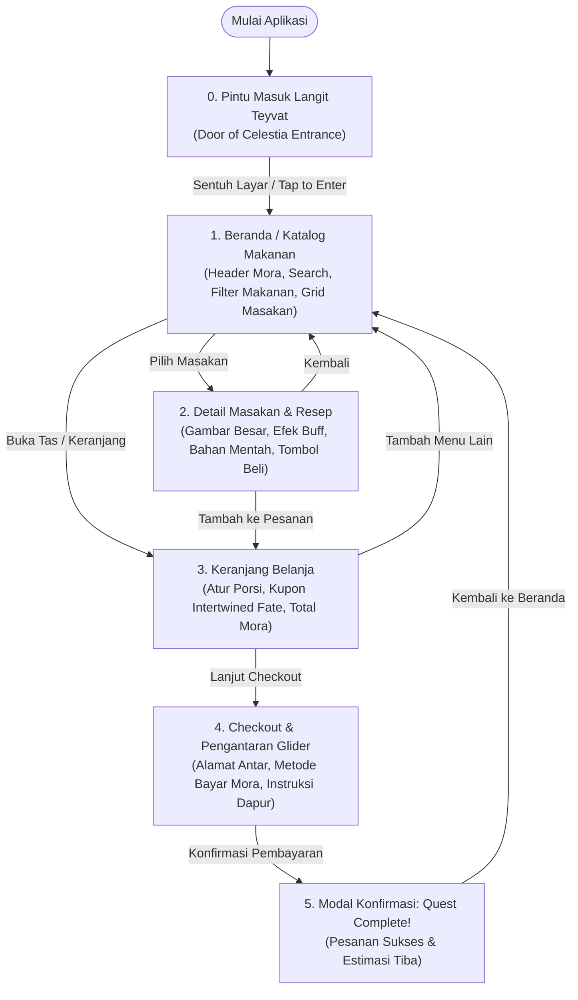

# Blueprint Arsitektur UI/UX, Flowchart Alur & Audit Aset Aplikasi Pemesanan Makanan (Genshin Style)

* **Mata Kuliah**: Pemrograman Visual I (`TI361`) — Tugas 7
* **Mahasiswa**: Badar Rahman (NIM `14524303`, Kelas `TI-1`, Semester 5)
* **Tujuan Dokumen**: Panduan konsep, rancangan visual per halaman, diagram alur (*Flowchart*), serta audit kelengkapan aset untuk perancangan di **Google Stitch / AI Studio** sebelum pengodean React Native.

---

## 1. Flowchart Alur Pengguna (User Journey Flowchart)

---

## 2. Gambaran UI/UX & Spesifikasi Wireframe Tiap Halaman

### Halaman 0: Pintu Masuk Langit Teyvat (Splash / Entrance Screen)
* **Visual Background**: Langit malam Teyvat dengan gradasi biru dongker (`#1D1A2A` ke `#312B47`) berpadu pilar batu langit dan awan tipis.
* **Elemen Tengah (Hero)**:
  * Logo judul emas: **"TEYVAT DELICACIES"** menggunakan font resmi `GenshinFont` (`HYWenHei 85W`).
  * Subjudul: *"Layanan Pemesanan Kuliner Resmi 8 Bangsa Teyvat"*.
* **Interaksi Bawah**: Teks tombol berkedip lembut (*pulsing animation*): *"Sentuh Layar untuk Memulai Pesanan (Tap to Enter)"*.

---

### Halaman 1: Beranda & Katalog Makanan (Catalog Screen)
* **Header Bar**:
  * Sisi Kiri: Avatar Traveler (Aether/Lumine) + Teks sapaan: *"Halo, Traveler!"*.
  * Sisi Kanan: Badge koin emas Mora (` Mora 1.452.430 Mora`) dengan border emas tipis.
* **Bilah Pencarian (Search Bar)**:
  * Kotak pencarian warna krem muda (`#F5F2EB`) berikon kaca pembesar: *"Cari masakan atau efek buff..."*.
* **Filter Kategori Simpel (Horizontal Scroll Chips)**:
  * `Semua Menu`, `Makanan Utama`, `Camilan / Snack`, `Minuman Segar`.
  * *(Tag Filter Opsional)*: Rarity Bintang (*1 s/d *5) atau Region Tag (*Mondstadt, Liyue, Nod-Krai, dll.*).
* **Grid Masakan Two-Tone (Card Catalog)**:
  * **Header Kartu**: Banner warna gradasi sesuai bintang masakan (1* Abu-abu, 2* Hijau, 3* Biru, 4* Ungu, 5* Emas) berpadu ilustrasi makanan transparan dan bintang belah ketupat di sudut kiri bawah.
  * **Body Kartu**: Kertas kuno krem (`#E9E5DC`), memuat nama masakan dalam font tebal, badge efek buff mini (misal: *ATK +372*), harga koin Mora ( Mora 12.500), dan tombol tambah mini `+`.
* **Bilah Keranjang Melayang (Floating Quick Cart Bar)**:
  * Strip melayang di bagian bawah layar jika keranjang berisi item, menampilkan ringkasan jumlah pesanan dan total Mora dengan tombol *"Buka Tas Belanja"*.

---

### Halaman 2: Detail Masakan & Resep (Dish Dossier Screen)
* **Top Bar Navigasi**: Tombol panah kembali emas (*Back Arrow*) dan tombol favorit.
* **Hero Image Display**:
  * Tampilan makanan transparan besar (256x256 px) di atas lingkaran pendaran elemen.
  * Deretan bintang belah ketupat 4-point (`*`) berkilau emas.
* **Panel Informasi Kertas Krem (`#E9E5DC`)**:
  * Judul Masakan dalam font `GenshinFont`.
  * Label asal masakan (misal: *Spesialisasi Nod-Krai* atau *Spesialisasi Liyue*).
  * **Kotak Khasiat Buff**: Ikon buff resmi pedang/perisai + teks efek status in-game (misal: *Meningkatkan ATK tim sebesar 372 poin dan CRIT Rate 12% selama 300 detik*).
  * **Grid Bahan Masakan Mentah (Ingredients)**: Deretan kotak transparan berisi ikon bahan (Daging, Jamur, Bunga Manis, Kepiting) dengan angka takaran resep.
  * **Kisah & Asal-usul Menu (Lore)**: Deskripsi cerita latar belakang masakan.
* **Bottom Action Bar**:
  * Selector kuantitas porsi: `[ - ]   1   [ + ]`.
  * Tombol Kapsul Emas Memanjang (*Primary Gold Pill Button*): *"Tambah ke Keranjang —  Mora 12.500 Mora"*.

---

### Halaman 3: Keranjang Belanja (Traveler's Feast Bag Screen)
* **Header**: Judul *"Tas Pesanan Traveler"* dengan tombol bersihkan daftar.
* **Daftar Item Pesanan**:
  * Kartu item berisi thumbnail makanan transparan di sisi kiri.
  * Nama masakan dan harga satuan koin Mora.
  * Kontrol kuantitas instan (`-` dan `+`) serta tombol hapus (*trash icon*).
* **Kolom Kupon Diskon Fates**:
  * Input kupon promo berikon tiket *Intertwined Fate* (misal kode: `PAIMONKENYANG` untuk potongan ongkir kurir glider).
* **Ringkasan Kalkulasi Biaya (Summary Card)**:
  * Subtotal Biaya Makanan
  * Ongkir Kurir Glider Favonius Express
  * Diskon Kupon
  * **Total Akhir Pembayaran ( Mora Mora)**
* **Tombol Pembayaran**: Tombol emas memanjang *"Lanjut ke Pembayaran Glider"*.

---

### Halaman 4: Checkout & Ringkasan Pemesanan (Checkout Screen)
* **Titik Antar Pengiriman**:
  * Opsi lokasi instan: *Markas Knights of Favonius*, *Teras Restoran Wanmin*, *Kuil Narukami*, *Maison Cardinalice*, atau alamat kampus Cirebon.
* **Pilihan Metode Pembayaran**:
  * Bayar Tunai Koin Mora ke Kurir (*Cash on Delivery*)
  * Northland Bank Transfer (Kartu Debit Teyvat)
* **Catatan Khusus untuk Dapur**:
  * Form catatan preferensi rasa (misal: *"Jangan pakai cabai Jueyun Chili terlalu banyak"*).
* **Tombol Bayar & Kirim**: Tombol kapsul emas *"Kirim Pesanan Sekarang"*.
* **Pop-up Sukses (Modal Dialog "Quest Complete!")**:
  * Kotak dialog berbingkai emas dengan tulisan besar: **"QUEST COMPLETE: Feast Delivered!"**.
  * Rincian pesanan berhasil dibuat, estimasi kurir tiba (15 menit), dan tombol *"Kembali ke Beranda"*.

---

## 3. Audit Inventaris Aset: Status Kelengkapan 100% Siap Pakai

Semua aset yang dibutuhkan aplikasi telah berhasil dikumpulkan, diunduh, dan diaudit tanpa ada yang kurang:

| No | Kategori Aset | Status | Lokasi Berkas Lokal / Referensi |
| :-: | :--- | :---: | :--- |
| 1 | **Font Resmi Genshin** | [Selesai] 100% Siap | `zhcn.ttf` / `GenshinFont.ttf` (HYWenHei 85W, 7.2 MB) di `assets/fonts/` |
| 2 | **Icon Font Vektor SVG** | [Selesai] 100% Siap | `genshin_icons.svg` (87 glyphs ikon murni Genshin SVG) di `assets/fonts/` |
| 3 | **Wallpaper Pintu Gerbang Celestia (5K & 1080p)** | [Selesai] 100% Siap | `genshin_celestia_login_door_5k.png` (21 MB) & `1080p.webp` (243 KB) di `assets/backgrounds/` |
| 4 | **Background Atmosfer & Partikel** | [Selesai] 100% Siap | `celestia_entrance_bg.webp`, `dish_detail_bg.webp`, `constellation_stars_bg.webp` di `assets/backgrounds/` |
| 5 | **Audio BGM & SFX Resmi Teyvat** | [Selesai] 100% Siap | `teyvat_ambient_bgm.ogg`, `quest_complete_jingle.ogg`, SFX bintang 4 & 5 di `assets/audio/` |
| 6 | **UI Textures & Maskot Paimon** | [Selesai] 100% Siap | `genshin_logo.webp`, `gold_button_texture.webp`, `paimon_hungry_mascot.png`, `result_card_bg.webp` di `assets/ui/` |
| 7 | **Ikon Mata Uang & Utilitas Transparan** | [Selesai] 100% Siap | `mora.png`, `primogem.png`, `genesis_crystal.png`, `intertwined_fate.png`, `fragile_resin.png` di `assets/icons/` |
| 8 | **Ikon Khasiat Efek Buff Makanan** | [Selesai] 100% Siap | `buff_atk_add.png`, `buff_atk_crit.png`, `buff_def_add.png`, `buff_recovery_hp.png`, `buff_revive.png`, `buff_stamina_reduce.png` di `assets/icons/` |
| 9 | **Latar Grading Rarity Bintang** | [Selesai] 100% Siap | `bg_3star.webp`, `bg_4star.webp`, `bg_5star.webp`, `resultcard_bg.svg` di `assets/icons/` |
| 10 | **12 Masakan Ikonik Transparan (Mode Offline)** | [Selesai] 100% Siap | Adeptus Temptation, Sweet Madame, Barbatos Ratatouille, Almond Tofu, Jade Parcels, dll di `assets/dishes/` |
| 11 | **Katalog Lengkap Online (Mode Online/Stream)** | [Selesai] 100% Siap | 400+ Transparent PNG masakan via Project Amber (`gi.yatta.moe`) & Enka Network |

---

## 4. Rekomendasi Prompt untuk Google Stitch / AI Studio

Salin prompt di bawah ini ke Google Stitch atau AI Studio (Prompt telah disesuaikan agar anti-slop, melarang emoji unicode, dan hanya menggunakan aset resmi):

> *"Build a production-grade React Native & Expo mobile food ordering application UI named 'Teyvat Delicacies' featuring an authentic, meticulous Genshin Impact fantasy RPG aesthetic.*
>
> *CRITICAL DESIGN RULES (ANTI-SLOP & STRICT THEME FIDELITY):*
> *1. ABSOLUTE BAN ON UNICODE EMOJIS: Do NOT use unicode emojis (no coin, sword, shield, cart, gem, checkmark, heart emojis). Use official Genshin asset transparent PNGs or SVGs provided in the asset list, or clean text labels.*
> *2. Color Palette: Card Content Body in authentic parchment cream (#E9E5DC), inner containers (#F5F2EB), dark obsidian navy background (#171421 / #1D1A2A), gold accent borders (#FFE7A5), and elongated gold pill buttons (gradient #ECE5D8 to #D3BC8E, border #FFE7A5).*
> *3. Typography: Primary headings & titles must use the official Genshin display font HYWenHei 85W ('GenshinFont').*
> *4. Currency & Motifs: Currency is Mora. Use the official Mora coin icon (assets/icons/mora.png or CDN). All star ratings use 4-point diamond star motifs (*), never generic 5-point cartoon stars. Bullet points use diamond shapes (◆).*
>
> *PAGES TO RENDER (CLEAN, 4-SCREEN FOCUSED FLOW):*
> *1. Catalog Screen (Home): Header with Traveler avatar, Mora balance, search input, horizontal category chips, and Two-Tone Food Card Grid with star rarity headers, parchment cream body, and mini gold '+' button.*
> *2. Dish Detail Screen: Hero transparent dish image, 4-point diamond stars, parchment stats card with official buff icon, ingredients grid, and gold button 'Add to Order'.*
> *3. Cart Screen: Itemized list with steppers, Intertwined Fate coupon input, order summary card, and gold button 'Proceed to Glider Delivery'.*
> *4. Checkout & Order Complete: Delivery point selector, Mora payment toggle, kitchen notes, and a 'Confirm Order' button triggering a golden modal dialog 'QUEST COMPLETE: Feast Delivered!'.*
>
> *LOCAL ASSETS (READY IN PROJECT):*
> *- Fonts: assets/fonts/GenshinFont.ttf, assets/fonts/genshin_icons.svg*
> *- Backgrounds: assets/backgrounds/genshin_celestia_login_door_1080p.webp, dish_detail_bg.webp*
> *- Audio: assets/audio/teyvat_ambient_bgm.ogg, quest_complete_jingle.ogg*
> *- UI & Icons: assets/ui/genshin_logo.webp, paimon_hungry_mascot.png, assets/icons/mora.png, primogem.png, buff_atk_add.png, buff_def_add.png, buff_recovery_hp.png*
> *- Dishes: assets/dishes/adeptus_temptation.png, sweet_madame.png, barbatos_ratatouille.png, jade_parcels.png"*
