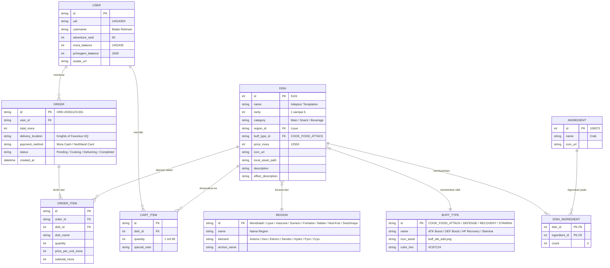

# Model Data, Skema Relasi Entitas (ERD) & Kontrak State UI/UX

* **Mata Kuliah**: Pemrograman Visual I (`TI361`) — Tugas 7
* **Mahasiswa**: Badar Rahman (NIM `14524303`, Kelas `TI-1`, Semester 5)
* **Aplikasi**: *Teyvat Delicacies* (Aplikasi Pemesanan Makanan Bertema Genshin Impact)
* **Tujuan Dokumen**: Sebagai acuan kontrak data (*Data Contract*), definisi TypeScript interface, skema relasi entitas (ERD), dan struktur state manajemen untuk Google AI Studio / Google Stitch serta pengembangan React Native + Expo.

---

## 1. Diagram Relasi Entitas (Entity Relationship Diagram - ERD)



---

## 2. Definisi TypeScript Interfaces (Kontrak Data Frontend)

Gunakan interface berikut di lingkungan React Native / Expo agar struktur data *type-safe*:

```typescript
// 1. Tipe Data Wilayah & Elemen Teyvat
export type TeyvatRegion =
  | 'Mondstadt'
  | 'Liyue'
  | 'Inazuma'
  | 'Sumeru'
  | 'Fontaine'
  | 'Natlan'
  | 'Nod-Krai'
  | 'Snezhnaya';

export type TeyvatElement =
  | 'Anemo'
  | 'Geo'
  | 'Electro'
  | 'Dendro'
  | 'Hydro'
  | 'Pyro'
  | 'Cryo';

// 2. Kategori Buff Khasiat
export type BuffCategory =
  | 'COOK_FOOD_ATTACK'
  | 'COOK_FOOD_DEFENSE'
  | 'COOK_FOOD_RECOVERY'
  | 'COOK_FOOD_STAMINA';

// 3. Bahan Baku Masakan
export interface DishIngredient {
  id: number;
  name: string;
  count: number;
  iconUrl?: string;
}

// 4. Entitas Utama Masakan (Dish)
export interface Dish {
  id: number;
  name: string;
  rarity: 1 | 2 | 3 | 4 | 5;
  category: 'Main Dish' | 'Snacks' | 'Beverages';
  region: TeyvatRegion;
  buffType: BuffCategory;
  buffLabel: string; // contoh: "ATK +372"
  priceMora: number;
  iconUrl: string; // URL transparan online (Project Amber / Enka)
  localAsset?: string; // Path aset lokal (assets/dishes/...)
  description: string;
  effect: string;
  ingredients: DishIngredient[];
  isSpecialty?: boolean;
  characterName?: string;
}

// 5. Item dalam Keranjang Belanja (Cart)
export interface CartItem {
  dish: Dish;
  quantity: number;
  notes?: string;
}

// 6. Profil Pengguna (Traveler)
export interface TravelerProfile {
  uid: string; // "14524303"
  username: string; // "Badar Rahman"
  adventureRank: number; // 60
  worldLevel: number; // 8
  moraBalance: number; // 1,452,430
  primogemBalance: number; // 1,600
  avatarUrl: string;
}

// 7. Entitas Pesanan & Checkout
export interface Order {
  id: string; // "ORD-TEYVAT-7721"
  items: CartItem[];
  subtotalMora: number;
  deliveryFeeMora: number; // 500 Mora (Gratis jika ada kupon Fragile Resin)
  discountMora: number;
  totalMora: number;
  deliveryLocation: string;
  kitchenNotes?: string;
  paymentMethod: 'MORA_COD' | 'NORTHLAND_BANK_CARD';
  status: 'COOKING' | 'GLIDER_DISPATCHED' | 'COMPLETED';
  createdAt: string;
}
```

---

## 3. Relasi Alur Layar ke State Data (Screen-to-State Mapping)

| Layar / Screen | File Rute Expo | State yang Digunakan | Aksi Pengguna & Mutasi State |
| :--- | :--- | :--- | :--- |
| **0. Splash Entrance** | `app/index.tsx` | `isAudioLoaded`, `isFontLoaded` | Ketuk layar -> Masuk ke Katalog (`router.replace('/(tabs)')`) |
| **1. Katalog Masakan** | `app/(tabs)/index.tsx` | `dishes[]`, `searchQuery`, `activeCategory`, `moraBalance` | Filter masakan, cari menu, klik item -> `router.push('/dish/[id]')`, klik `+` -> `addToCart(dish)` |
| **2. Eksplorasi & Filter** | `app/(tabs)/explore.tsx` | `selectedBuffs[]`, `selectedRarities[]`, `selectedRegions[]` | Multi-filter berdasarkan buff stats atau bangsa Teyvat (termasuk Nod-Krai) |
| **3. Tas Belanja** | `app/(tabs)/cart.tsx` | `cartItems[]`, `couponCode`, `totalMora` | Tambah/kurang porsi, masukkan kupon Intertwined Fate, klik `Lanjut Checkout` |
| **4. Profil Petualang** | `app/(tabs)/profile.tsx` | `TravelerProfile`, `orderHistory[]` | Melihat saldo Mora, Primogem, riwayat petualangan kuliner |
| **5. Detail Masakan** | `app/dish/[id].tsx` | `dishDetail`, `stepperQuantity` | Baca resep & lore masakan, tentukan porsi, klik `Tambah ke Pesanan` |
| **6. Checkout Pengantaran** | `app/checkout.tsx` | `deliveryLocation`, `paymentMethod`, `kitchenNotes` | Pilih markas pengantaran, konfirmasi bayar -> trigger SFX & modal sukses |
| **7. Pelacakan & Sukses** | `app/order-status.tsx` | `activeOrder`, `deliveryTimeMinutes` | Animasi kurir glider & modal dialog `"QUEST COMPLETE: Feast Delivered!"` |

---

## 4. Format State Manajemen Global (Zustand / Context Store)

```typescript
interface DelicaciesStore {
  // State Keranjang
  cart: CartItem[];
  addToCart: (dish: Dish, qty?: number) => void;
  removeFromCart: (dishId: number) => void;
  updateQuantity: (dishId: number, qty: number) => void;
  clearCart: () => void;
  
  // Kalkulasi
  getTotalMora: () => number;
  getTotalItems: () => number;
  
  // State Kupon
  appliedCoupon: string | null;
  applyCoupon: (code: string) => boolean;

  // Profil
  profile: TravelerProfile;
  deductMora: (amount: number) => boolean;

  // Transaksi
  orders: Order[];
  placeOrder: (orderData: Omit<Order, 'id' | 'createdAt' | 'status'>) => Order;
}
```
