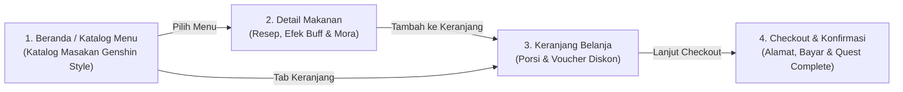

# Master Blueprint: Konsep Aplikasi, Arsitektur Halaman & Sistem Desain Genshin Impact

* **Mata Kuliah**: Pemrograman Visual I (`TI361`) — Tugas 7 (Food Catalog & Order App)
* **Mahasiswa**: Badar Rahman (NIM `14524303`, Kelas `TI-1`, Semester 5)
* **Status**: Tahap Konseptual & Pengumpulan Aset Lengkap (Belum Mulai Koding)
* **Basis Teknologi**: React Native, Expo Router, TypeScript, Custom Genshin Design System

---

## 1. Verifikasi Font Resmi Genshin Impact

Berkas font yang diunduh Badar di folder Downloads telah diperiksa:
* **Berkas Unduhan**: `C:\Users\Pongo\Downloads\hywenhei-cufonfonts.zip`
* **Nama Berkas Font Asli**: `zhcn.ttf` (Ukuran: 6.9 MB / 7.232.220 bytes).
* **Identitas Tipografi**: **HYWenHei 85W** (`汉仪文黑-85W`), font *sans-serif display* tebal dengan kurva sudut lembut yang menjadi ciri khas antarmuka resmi miHoYo / HoYoverse di *Genshin Impact*.
* **Status Ekstraksi**: Sudah diekstrak dan disiapkan di direktori proyek:
  * [`assets/fonts/zhcn.ttf`](file:///C:/Users/Pongo/Documents/Codingan/Tugas_Pemvis/Tugas_7/assets/fonts/zhcn.ttf)
  * [`assets/fonts/GenshinFont.ttf`](file:///C:/Users/Pongo/Documents/Codingan/Tugas_Pemvis/Tugas_7/assets/fonts/GenshinFont.ttf) (Salinan alias siap import di Expo via `expo-font`).

---

## 2. Arsitektur Halaman yang Simpel & Terfokus (Sesuai Arahan Badar)

Sesuai keinginan pengguna agar **aplikasi tetap simpel, ringan, dan tidak ribet dengan sistem region**, navigasi utama difokuskan pada alur belanja makanan yang bersih (*pure food ordering flow*):



### 4 Halaman Inti (Sesuai Ketentuan Tugas 7):

1. **Halaman 1 — Beranda & Katalog Makanan (`app/(tabs)/index.tsx`)**:
   * **Header Sederhana**: Saldo koin Mora ( Mora 1.452.430), judul toko kuliner Teyvat, dan kolom pencarian.
   * **Kategori Menu Cepat**: Filter simpel berbasis kategori masakan:
     * *Semua Menu*
     * *Makanan Utama (Main Dish)*
     * *Camilan / Snack*
     * *Minuman Segar (Beverages)*
     * *(Opsional)* Filter berdasarkan Rarity (*1 s/d *5) atau Asal Region (Mondstadt, Liyue, Inazuma, Sumeru, Fontaine, Natlan, **Nod-Krai**, Snezhnaya).
   * **Daftar Masakan (Genshin Style Grid)**: Kartu *two-tone* dengan banner kelangkaan di atas dan kertas krem kuno (`#E9E5DC`) di bawah.
2. **Halaman 2 — Detail Makanan (`app/dish/[id].tsx`)**:
   * Ilustrasi makanan transparan berukuran besar.
   * Bintang belah ketupat (`*`), khasiat buff status in-game, dan resep bahan mentah.
   * Selector porsi kuantitas (`-` / `+`) dan tombol kapsul emas memanjang ("Tambah ke Keranjang").
3. **Halaman 3 — Keranjang Belanja (`app/(tabs)/cart.tsx`)**:
   * Daftar masakan yang dipesan dengan pengaturan kuantitas langsung.
   * Kolom input kupon diskon berikon *Intertwined Fate* (misal: `PAIMONKENYANG`).
   * Rincian total koin Mora.
4. **Halaman 4 — Checkout & Ringkasan Pemesanan (`app/checkout.tsx`)**:
   * Pilihan alamat antar singkat & catatan untuk koki.
   * Metode pembayaran: Tunai Koin Mora atau Northland Bank.
   * Tombol "Konfirmasi Pesanan" yang memunculkan pop-up modal sukses bergaya **"QUEST COMPLETE"** berbingkai emas.

---

## 3. Catatan Region: Penegasan Nod-Krai (Sebelum Snezhnaya)
Sesuai pembaruan semesta Teyvat versi 6.x:
* Wilayah perbatasan sebelum Snezhnaya adalah **Nod-Krai** (wilayah mandiri bernuansa Nordik / Skandinavia / Baltik tempat bertemunya ekspedisi Varka, guild petualang, dan Hexenzirkel).
* Dalam aplikasi ini, informasi region **tidak dijadikan sistem navigasi yang rumit**, melainkan murni sebagai **label asal (tag / chip opsional)** pada kartu makanan bagi yang ingin menyaring masakan berdasarkan daerah.

---

## 4. Cara Mendapatkan & Mengintegrasikan Aset Visual (Pintu Masuk, UI & Gambar)

1. **Aset Gambar Makanan & Ikon UI (CDN Langsung / Transparent PNG)**:
   * Menggunakan URL CDN dari repositori ekstraksi game resmi (`gi.yatta.moe` Project Amber, `enka.network`, dan `kgirtxd/Genshin-Assets` di GitHub).
   * Berkas sudah transparan murni, tanpa latar belakang putih, dan langsung dipanggil via `source={{ uri: '...' }}` di React Native.
2. **Aset Pintu Masuk / Latar Belakang (Celestia Gateway)**:
   * Dapat menggunakan visual *Door of Resurrection / Celestia Gateway* dari arsip Fandom Wiki / Wallpaper HoyoLAB resmi.
   * Atau dibuat secara elegan menggunakan kombinasi linear gradient langit malam Teyvat (`#1D1A2A` ke `#312B47`) dengan ornamen pilar dan partikel bintang emas.
3. **Gaya Komponen UI Vektor (Tombol Emas & Divider)**:
   * Dibuat menggunakan StyleSheet murni React Native (mengombinasikan border radius pill `borderRadius: 9999`, gradasi emas `#ECE5D8` ke `#D3BC8E`, dan bayangan halus `elevation` / `box-shadow`) sehingga sangat tajam, ringan, dan tidak pecah di resolusi layar mana pun.

---

## 3. Strategi Manajemen Aset Gambar PNG (Solusi Performa & Caching)

Pertanyaan penting dalam implementasi mobile: *Dengan banyaknya aset PNG transparan (makanan, ikon buff, elemen, bingkai), bagaimana agar aplikasi tetap ringan, tidak lemot, dan tidak boros memori?*

Berikut arsitektur performa yang diterapkan:

### 1. Menggunakan Pustaka `expo-image` (Bukan `<Image />` Bawaan React Native Biasa)
* **Mesin Native Berkualitas Tinggi**: `expo-image` menggunakan mesin **SDWebImage** di iOS dan **Glide** di Android.
* **Otomatis Caching Cerdas (Disk & Memory Cache)**: Gambar yang dimuat dari CDN hanya diunduh 1 kali. Begitu terunduh, gambar disimpan di memori ponsel dan cache disk, sehingga saat dibuka kembali gambarnya langsung muncul secara instan (0 milidetik latency) bahkan dalam mode offline.
* **Bebas Kedipan Putih (No White Flicker)**: Mendukung fitur `placeholder` (warna krem kertas kuno `#E9E5DC` atau blurhash), sehingga transisi saat memuat gambar terasa sangat halus dan elegan.
* **Transisi Halus**: Mendukung properti `transition={250}` untuk efek *fade-in* lembut saat gambar pertama kali tampil.

### 2. Efisiensi Ukuran Berkas & Alokasi RAM
* Setiap ikon transparan PNG dari CDN hanya berukuran rata-rata **20 KB hingga 55 KB** (resolusi 256x256 px).
* Memuat 25 menu makanan sekaligus dalam `FlatList` hanya memakan memori sekitar **~1,2 MB RAM**, sangat jauh di bawah batas toleransi perangkat seluler modern (HP entry-level sekalipun memiliki RAM 3-4 GB).

### 3. Registry Aset Modular (`src/constants/assetsRegistry.ts`)
Seluruh pemetaan URL CDN tidak ditulis berulang-ulang di file tampilan (komponen), melainkan dipusatkan dalam satu modul terstruktur:
* `getDishIcon(dishId: string): string`
* `getBuffIcon(buffType: BuffType): string`
* `getElementIcon(element: ElementType): string`
* `getRegionEmblem(region: RegionType): string`
* `getRarityFrame(stars: number): string`

### 4. Skeleton Shimmer Khusus Bertema Kertas Kuno
Saat data pertama kali dimuat, aplikasi menampilkan efek *shimmering skeleton* dengan gradasi warna krem keemasan (`#E9E5DC` ke `#D3BC8E`), memberikan kesan premium dan bukan sekadar kotak abu-abu generic.

---

## 4. Katalog Lengkap Aset UI Non-Makanan (Direct CDN)

Semua aset di bawah ini berformat **Transparent PNG murni** dan dapat dipanggil langsung melalui properti `source={{ uri: '...' }}` di React Native:

### A. Ikon Navigasi & Sistem Antarmuka

| Fungsi UI | Nama Aset / File | Direct CDN Link |
| :--- | :--- | :--- |
| **Tas / Keranjang (Bag/Cart)** | `items.png` | `https://raw.githubusercontent.com/kgirtxd/Genshin-Assets/master/Misc/items.png` |
| **Kembali (Back Arrow Gold)** | `ic_arrow left.png` | `https://raw.githubusercontent.com/kgirtxd/Genshin-Assets/master/Misc/ic_arrow%20left.png` |
| **Lanjut (Next Arrow Gold)** | `ic_arrow right.png` | `https://raw.githubusercontent.com/kgirtxd/Genshin-Assets/master/Misc/ic_arrow%20right.png` |
| **Centang Sukses (Checkmark)** | `check.png` | `https://raw.githubusercontent.com/kgirtxd/Genshin-Assets/master/Misc/check.png` |
| **Pengaturan (Settings)** | `settings.png` | `https://raw.githubusercontent.com/kgirtxd/Genshin-Assets/master/Misc/settings.png` |
| **Beranda (Home)** | `home.png` | `https://raw.githubusercontent.com/kgirtxd/Genshin-Assets/master/Misc/home.png` |
| **Avatar Traveler Aether** | `UI_AvatarIcon_PlayerBoy.png` | `https://enka.network/ui/UI_AvatarIcon_PlayerBoy.png` |
| **Avatar Traveler Lumine** | `UI_AvatarIcon_PlayerGirl.png` | `https://enka.network/ui/UI_AvatarIcon_PlayerGirl.png` |
| **Emblem Wilayah Mondstadt** | `UI_ChapterIcon_Mengde.png` | `https://raw.githubusercontent.com/kgirtxd/Genshin-Assets/master/Misc/AreaIcons/UI_ChapterIcon_Mengde.png` |
| **Emblem Wilayah Liyue** | `UI_ChapterIcon_Liyue.png` | `https://raw.githubusercontent.com/kgirtxd/Genshin-Assets/master/Misc/AreaIcons/UI_ChapterIcon_Liyue.png` |
| **Emblem Wilayah Inazuma** | `UI_ChapterIcon_Daoqi.png` | `https://raw.githubusercontent.com/kgirtxd/Genshin-Assets/master/Misc/AreaIcons/UI_ChapterIcon_Daoqi.png` |
| **Emblem Wilayah Sumeru** | `UI_ChapterIcon_Xumi.png` | `https://raw.githubusercontent.com/kgirtxd/Genshin-Assets/master/Misc/AreaIcons/UI_ChapterIcon_Xumi.png` |

### B. Ikon Mata Uang, Poin & Voucher Promo

| Item | Fungsi dalam Aplikasi | Direct CDN Link |
| :--- | :--- | :--- |
| **Koin Mora** ( Mora) | Mata uang utama pembayaran belanja | `https://enka.network/ui/UI_ItemIcon_202.png` |
| **Primogem** ( Primogem) | Poin loyalty reward setelah belanja | `https://enka.network/ui/UI_ItemIcon_201.png` |
| **Genesis Crystal** | Saldo top-up akun | `https://enka.network/ui/UI_ItemIcon_203.png` |
| **Intertwined Fate** | Tiket voucher diskon / kupon potongan harga | `https://enka.network/ui/UI_ItemIcon_223.png` |
| **Acquaint Fate** | Kupon promo belanja pertama | `https://enka.network/ui/UI_ItemIcon_224.png` |
| **Fragile Resin** ([Welkin Moon]) | Voucher pengiriman kilat (Express Courier) | `https://enka.network/ui/UI_ItemIcon_210.png` |

### C. Ikon Khasiat & Efek Buff Makanan Resmi (Yatta Moe CDN)

| Kategori Buff | Deskripsi Efek | Direct CDN Link |
| :--- | :--- | :--- |
| **ATK Boost (Pedang)** | Tambahan daya serang tim | `https://gi.yatta.moe/assets/UI/UI_Buff_Item_Atk_Add.png` |
| **CRIT Rate (Crosshair)** | Tambahan peluang serangan kritis | `https://gi.yatta.moe/assets/UI/UI_Buff_Item_Atk_CritRate.png` |
| **DEF Boost (Perisai)** | Pertahanan dan daya tahan tim | `https://gi.yatta.moe/assets/UI/UI_Buff_Item_Def_Add.png` |
| **HP Recovery (Hati/Darah)** | Pemulihan HP karakter | `https://gi.yatta.moe/assets/UI/UI_Buff_Item_Recovery_HpAdd.png` |
| **Party HP Heal (Grup)** | Pemulihan darah seluruh anggota tim | `https://gi.yatta.moe/assets/UI/UI_Buff_Item_Recovery_HpAddAll.png` |
| **Revive (Sayap Malaikat)** | Membangkitkan karakter yang pingsan | `https://gi.yatta.moe/assets/UI/UI_Buff_Item_Recovery_Revive.png` |
| **Stamina Add (Stamina)** | Mengembalikan stamina instan | `https://gi.yatta.moe/assets/UI/UI_Buff_Item_Other_SPAdd.png` |
| **Stamina Sprint (Lari/Glider)**| Pengurangan konsumsi stamina lari | `https://gi.yatta.moe/assets/UI/UI_Buff_Item_Other_SPReduceConsume.png` |

### D. Ikon 7 Elemen Teyvat (Transparent PNG)

| Elemen | Wilayah Asosiasi | Direct CDN Link |
| :--- | :--- | :--- |
| **Anemo (Angin)** | Mondstadt | `https://raw.githubusercontent.com/kgirtxd/Genshin-Assets/master/Elements/element_anemo.png` |
| **Geo (Tanah)** | Liyue | `https://raw.githubusercontent.com/kgirtxd/Genshin-Assets/master/Elements/element_geo.png` |
| **Electro (Petir)** | Inazuma | `https://raw.githubusercontent.com/kgirtxd/Genshin-Assets/master/Elements/element_electro.png` |
| **Dendro (Tumbuhan)**| Sumeru | `https://raw.githubusercontent.com/kgirtxd/Genshin-Assets/master/Elements/element_dendro.png` |
| **Hydro (Air)** | Fontaine | `https://raw.githubusercontent.com/kgirtxd/Genshin-Assets/master/Elements/element_hydro.png` |
| **Pyro (Api)** | Natlan | `https://raw.githubusercontent.com/kgirtxd/Genshin-Assets/master/Elements/element_pyro.png` |
| **Cryo (Es)** | Snezhnaya | `https://raw.githubusercontent.com/kgirtxd/Genshin-Assets/master/Elements/element_cryo.png` |

### E. Bingkai & Texture Background Rarity Resmi (1* s/d 5*)

| Tingkat Kelangkaan | Frame Kartu Resmi | Background Texture Gradien |
| :---: | :--- | :--- |
| **1-Star (Common)** | `https://raw.githubusercontent.com/kgirtxd/Genshin-Assets/master/Misc/Glows/card_1.png` | `https://raw.githubusercontent.com/kgirtxd/Genshin-Assets/master/Misc/Glows/1_star_background.png` |
| **2-Star (Uncommon)** | `https://raw.githubusercontent.com/kgirtxd/Genshin-Assets/master/Misc/Glows/card_2.png` | `https://raw.githubusercontent.com/kgirtxd/Genshin-Assets/master/Misc/Glows/2_star_background.png` |
| **3-Star (Rare)** | `https://raw.githubusercontent.com/kgirtxd/Genshin-Assets/master/Misc/Glows/card_3.png` | `https://raw.githubusercontent.com/kgirtxd/Genshin-Assets/master/Misc/Glows/3_star_background.png` |
| **4-Star (Epic)** | `https://raw.githubusercontent.com/kgirtxd/Genshin-Assets/master/Misc/Glows/card_4.png` | `https://raw.githubusercontent.com/kgirtxd/Genshin-Assets/master/Misc/Glows/4_star_background.png` |
| **5-Star (Legendary)** | `https://raw.githubusercontent.com/kgirtxd/Genshin-Assets/master/Misc/Glows/card_5.png` | `https://raw.githubusercontent.com/kgirtxd/Genshin-Assets/master/Misc/Glows/5_star_background.png` |

---

## 4. Sistem Desain & Token Warna Hex Resmi

```typescript
// Token Warna Resmi Genshin Impact untuk React Native
export const GenshinTheme = {
  colors: {
    // Permukaan & Kertas
    parchment: '#E9E5DC',       // Latar utama kartu informasi & modal
    parchmentLight: '#F5F2EB',  // Latar sub-kontainer / kolom input
    backgroundDark: '#171421',  // Latar layar paling belakang
    surfaceDark: '#1D1A2A',     // Latar bar navigasi & panel
    modalDark: '#312B47',       // Latar dialog box
    borderIndigo: '#5D5187',    // Garis bingkai kartu luar
    borderGold: '#FFE7A5',      // Garis bingkai aksen emas

    // Tipografi Teks
    textParchmentDark: '#4A5366', // Teks isi di atas kertas krem
    textDarkHeading: '#1D1A2A',   // Judul nama makanan di kertas krem
    textLight: '#E9E5DC',         // Teks di atas latar gelap
    textGold: '#D49F3D',          // Teks harga Mora & subjudul emas

    // Aksen Emas & Bintang
    goldPrimary: '#D3BC8E',       // Warna utama tombol pill emas
    goldGradientStart: '#ECE5D8',
    goldGradientEnd: '#D3BC8E',
    starYellow: '#FFCC32',        // Warna bintang kelangkaan 4-point

    // Tier Kelangkaan (Rarity)
    rarity: {
      star1: '#818486',
      star2: '#5A977A',
      star3: '#5987AD',
      star4: '#9470BB',
      star5: '#C87C24',
    },

    // 7 Elemen
    elements: {
      anemo: '#48D9B4',
      geo: '#FAB632',
      electro: '#AF84FB',
      dendro: '#7AD43A',
      hydro: '#4CC2F9',
      pyro: '#EF7938',
      cryo: '#8FE4F2',
    }
  },

  fonts: {
    genshin: 'GenshinFont',     // Menggunakan zhcn.ttf (HYWenHei 85W)
    titleFantasy: 'Cinzel',     // Untuk nama header restoran
    numbers: 'Inter',           // Untuk kuantitas & nominal Mora
  }
};
```

---

## 5. Ringkasan Kesiapan Proyek

1. **Font**: `GenshinFont.ttf` (HYWenHei 85W) sudah tersimpan di folder aset lokal siap dimuat.
2. **Aset Gambar**: Semua direct link CDN (non-makanan dan makanan) sudah diverifikasi valid (HTTP 200) tanpa ketergantungan file lokal berat.
3. **Arsitektur Halaman**: 6 layar sudah didefinisikan secara komprehensif melampaui standar minimal 4 layar Tugas 7.
4. **Status Eksekusi**: Tetap berada dalam koridor diskusi; koding aplikasi baru akan dimulai jika Badar memberi instruksi pengerjaan.
