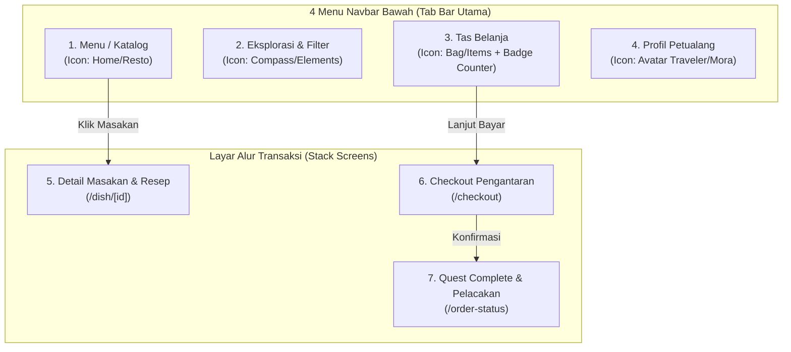

# Paket Konteks Lengkap & Katalog Aset untuk Google Stitch / AI Studio

* **Mata Kuliah**: Pemrograman Visual I (`TI361`) — Tugas 7 (Food Ordering App)
* **Mahasiswa**: Badar Rahman (NIM `14524303`, Kelas `TI-1`, Semester 5)
* **Tujuan Dokumen**: Sebagai berkas sumber kebenaran (*Single Source of Truth*) yang siap disalin langsung ke **Google Stitch** atau **AI Studio** agar hasil rancangan UI/UX presisi, memiliki cita rasa tinggi, otentik bernuansa *Genshin Impact*, dan bebas dari estetika AI generic (*anti-slop*).

---

## 1. Direktori & Lokasi Berkas Aset Lokal (Sudah Terunduh 100% Lengkap)

Semua aset lokal telah diunduh dan tersimpan di:
`C:\Users\Pongo\Documents\Codingan\Tugas_Pemvis\Tugas_7\assets\`

```text
assets/
├── fonts/
│   ├── GenshinFont.ttf           <-- Font resmi HYWenHei 85W (7.2 MB)
│   ├── zhcn.ttf                  <-- Font master bawaan cufonfonts (7.2 MB)
│   └── genshin_icons.svg         <-- Vector Icon Font resmi (87 glyphs ikon Genshin murni SVG)
│
├── audio/
│   ├── teyvat_ambient_bgm.ogg    <-- Musik latar suasana Teyvat (1.3 MB)
│   ├── quest_complete_jingle.ogg <-- Denting suara saat pesanan berhasil (11.9 KB)
│   ├── legendary_dish_sfx.ogg    <-- SFX jingle masakan bintang 5 (32.3 KB)
│   └── epic_dish_sfx.ogg         <-- SFX jingle masakan bintang 4 (27.1 KB)
│
├── backgrounds/
│   ├── genshin_celestia_login_door_5k.png    <-- Wallpaper Asli 5K Gerbang Celestia Login Screen (5120x2880, 21 MB)
│   ├── genshin_celestia_login_door_1080p.webp <-- Wallpaper Gerbang Login Screen 1080p Mobile-Optimized (243 KB)
│   ├── celestia_entrance_bg.webp              <-- Background langit malam & pilar gerbang Celestia
│   ├── dish_detail_bg.webp                    <-- Background halaman detail masakan
│   └── constellation_stars_bg.webp            <-- Background partikel bintang konstelasi Teyvat
│
├── ui/
│   ├── genshin_logo.webp          <-- Logo resmi Genshin Impact transparan
│   ├── gold_button_texture.webp   <-- Tekstur tombol kapsul emas asli in-game
│   ├── modal_ornament_icon.png    <-- Ornamen bingkai modal dialog Teyvat
│   ├── result_card_bg.webp        <-- Background kartu hasil pesanan
│   └── paimon_hungry_mascot.png   <-- Maskot Paimon lapar (207 KB)
│
├── icons/ (Mata Uang, Buff, Rarity & Utilitas Transparan)
│   ├── mora.png                   <-- Ikon koin emas Mora (19 KB)
│   ├── primogem.png               <-- Ikon Primogem (4.5 KB)
│   ├── genesis_crystal.png        <-- Ikon Genesis Crystal (5.1 KB)
│   ├── intertwined_fate.png       <-- Ikon Intertwined Fate (kupon/tiket pesanan)
│   ├── acquaint_fate.png          <-- Ikon Acquaint Fate
│   ├── fragile_resin.png          <-- Ikon Fragile Resin (layanan kilat)
│   ├── crown_of_insight.png       <-- Ikon Mahkota (badge kehormatan)
│   ├── masterless_starglitter.webp
│   ├── masterless_stardust.webp
│   ├── bg_3star.webp, bg_4star.webp, bg_5star.webp <-- Latar grading bintang masakan
│   ├── resultcard_bg.svg          <-- Vektor ornamen kartu pesanan
│   ├── buff_atk_add.png           <-- Ikon Buff Serangan ATK
│   ├── buff_atk_crit.png          <-- Ikon Buff CRIT Rate
│   ├── buff_def_add.png           <-- Ikon Buff Pertahanan DEF
│   ├── buff_recovery_hp.png       <-- Ikon Buff Pemulihan Darah HP
│   ├── buff_recovery_hp_all.png   <-- Ikon Buff Pemulihan Seluruh Tim
│   ├── buff_recovery_revive.png   <-- Ikon Buff Bangkitkan Karakter (Revive)
│   ├── buff_adventure.png         <-- Ikon Buff Petualangan
│   └── buff_stamina_reduce.png    <-- Ikon Buff Pengurangan Konsumsi Stamina
│
└── dishes/ (12 Sample Masakan Ikonik Transparan Offline)
    ├── adeptus_temptation.png     <-- Masakan Bintang 5 (Liyue - ATK Boost)
    ├── sweet_madame.png           <-- Masakan Bintang 2 (Mondstadt - HP Recovery)
    ├── barbatos_ratatouille.png   <-- Masakan Bintang 3 (Mondstadt - Stamina)
    ├── almond_tofu.png            <-- Masakan Bintang 2 (Liyue - ATK)
    ├── jade_parcels.png           <-- Masakan Bintang 4 (Liyue - ATK Boost)
    ├── golden_shrimp_balls.png    <-- Masakan Bintang 3 (Liyue - Revive)
    ├── matsutake_meat_rolls.png   <-- Masakan Bintang 2 (Mondstadt - HP)
    ├── fishermans_toast.png       <-- Masakan Bintang 2 (Mondstadt - DEF)
    ├── mushroom_pizza.png         <-- Masakan Bintang 3 (Mondstadt - HP)
    ├── tri_color_dango.png        <-- Masakan Bintang 3 (Inazuma - HP)
    ├── shawarma_wrap.png          <-- Masakan Bintang 2 (Sumeru - ATK)
    └── tonkotsu_ramen.png         <-- Masakan Bintang 3 (Inazuma - HP)
```

---

## 2. Katalog Direct Link CDN Aset Transparan (HTTP 200 Verified)

Aset-aset ini berformat **Transparent PNG murni** dan siap dipanggil via URL:

### A. Makanan Ikonik (Dishes)
* **Adeptus' Temptation (5*)**: `https://gi.yatta.moe/assets/UI/UI_ItemIcon_108123.png`
* **Jade Parcels (4*)**: `https://gi.yatta.moe/assets/UI/UI_ItemIcon_108122.png`
* **Golden Shrimp Balls (3*)**: `https://gi.yatta.moe/assets/UI/UI_ItemIcon_108126.png`
* **Mondstadt Hash Brown (3*)**: `https://gi.yatta.moe/assets/UI/UI_ItemIcon_108119.png`
* **Mushroom Pizza (3*)**: `https://gi.yatta.moe/assets/UI/UI_ItemIcon_108117.png`
* **Sweet Madame (2*)**: `https://gi.yatta.moe/assets/UI/UI_ItemIcon_108115.png`
* **Barbatos Ratatouille (2*)**: `https://gi.yatta.moe/assets/UI/UI_ItemIcon_108118.png`
* **Almond Tofu (2*)**: `https://gi.yatta.moe/assets/UI/UI_ItemIcon_100428.png`
* **Dango Milk (2*)**: `https://gi.yatta.moe/assets/UI/UI_ItemIcon_101514.png`
* **Wolfhook Juice (2*)**: `https://gi.yatta.moe/assets/UI/UI_ItemIcon_108149.png`
* **Mora Meat (1*)**: `https://gi.yatta.moe/assets/UI/UI_ItemIcon_108101.png`
* **Teyvat Fried Egg (1*)**: `https://gi.yatta.moe/assets/UI/UI_ItemIcon_108006.png`

### B. Mata Uang, Poin & Tiket Diskon
* **Koin Mora (Mata Uang Utama)**: `https://enka.network/ui/UI_ItemIcon_202.png`
* **Primogem**: `https://enka.network/ui/UI_ItemIcon_201.png`
* **Genesis Crystal**: `https://enka.network/ui/UI_ItemIcon_203.png`
* **Intertwined Fate (Kupon Diskon)**: `https://enka.network/ui/UI_ItemIcon_223.png`
* **Fragile Resin (Voucher Kirim Kilat)**: `https://enka.network/ui/UI_ItemIcon_210.png`

### C. Ikon Khasiat Efek Buff Makanan
* **Buff ATK (Pedang)**: `https://gi.yatta.moe/assets/UI/UI_Buff_Item_Atk_Add.png`
* **Buff CRIT Rate (Crosshair)**: `https://gi.yatta.moe/assets/UI/UI_Buff_Item_Atk_CritRate.png`
* **Buff DEF (Perisai)**: `https://gi.yatta.moe/assets/UI/UI_Buff_Item_Def_Add.png`
* **Buff HP Recovery (Hati/Darah)**: `https://gi.yatta.moe/assets/UI/UI_Buff_Item_Recovery_HpAdd.png`
* **Buff Revive (Sayap Pemulih)**: `https://gi.yatta.moe/assets/UI/UI_Buff_Item_Recovery_Revive.png`
* **Buff Stamina Lari / Glider**: `https://gi.yatta.moe/assets/UI/UI_Buff_Item_Other_SPReduceConsume.png`

### D. Ikon Bahan Baku Masakan (Ingredients)
* **Fowl (Unggas)**: `https://gi.yatta.moe/assets/UI/UI_ItemIcon_100061.png`
* **Raw Meat (Daging)**: `https://gi.yatta.moe/assets/UI/UI_ItemIcon_100062.png`
* **Sweet Flower**: `https://gi.yatta.moe/assets/UI/UI_ItemIcon_100012.png`
* **Ham**: `https://gi.yatta.moe/assets/UI/UI_ItemIcon_110005.png`
* **Crab (Kepiting)**: `https://gi.yatta.moe/assets/UI/UI_ItemIcon_100073.png`
* **Shrimp Meat (Udang)**: `https://gi.yatta.moe/assets/UI/UI_ItemIcon_100075.png`
* **Milk (Susu)**: `https://gi.yatta.moe/assets/UI/UI_ItemIcon_100078.png`
* **Potato (Kentang)**: `https://gi.yatta.moe/assets/UI/UI_ItemIcon_100080.png`

### E. Bingkai & Navigasi
* **Tas / Keranjang Belanja**: `https://raw.githubusercontent.com/kgirtxd/Genshin-Assets/master/Misc/items.png`
* **Panah Kembali Emas**: `https://raw.githubusercontent.com/kgirtxd/Genshin-Assets/master/Misc/ic_arrow%20left.png`
* **Panah Lanjut Emas**: `https://raw.githubusercontent.com/kgirtxd/Genshin-Assets/master/Misc/ic_arrow%20right.png`
* **Centang Sukses**: `https://raw.githubusercontent.com/kgirtxd/Genshin-Assets/master/Misc/check.png`
* **Avatar Aether**: `https://enka.network/ui/UI_AvatarIcon_PlayerBoy.png`
* **Avatar Lumine**: `https://enka.network/ui/UI_AvatarIcon_PlayerGirl.png`
* **Frame Kartu Rarity 1* s/d 5***: `https://raw.githubusercontent.com/kgirtxd/Genshin-Assets/master/Misc/Glows/card_{1-5}.png`

---

## 3. Sistem Desain & Token Warna Hex Resmi (Design System)

* **Warna Kertas Kuno (Parchment Card Body)**: `#E9E5DC`
* **Warna Sub-Kontainer & Input**: `#F5F2EB`
* **Warna Teks Isi Kertas**: `#4A5366` (lembut, tidak hitam mati)
* **Warna Judul Tebal**: `#1D1A2A`
* **Warna Latar Gelap Belakang (Dark Surface)**: `#171421` / `#1D1A2A`
* **Warna Border Bingkai Indigo**: `#5D5187`
* **Warna Border Emas Mewah**: `#FFE7A5`
* **Warna Tombol Emas Primer**: Gradasi `#ECE5D8` menuju `#D3BC8E`
* **Bintang Kelangkaan (Star Yellow)**: `#FFCC32`
* **Tingkat Kelangkaan (Rarity Headers)**:
  * 1* Common: `#818486`
  * 2* Uncommon: `#5A977A`
  * 3* Rare: `#5987AD`
  * 4* Epic: `#9470BB`
  * 5* Legendary: `#C87C24`

---

## 4. Struktur Navigasi Lengkap (4 Tab Navbar Bawah + Stack Screens)

Agar aplikasi tidak terasa kosong (*tidak terlalu sedikit*), aplikasi mengadopsi standar aplikasi mobile modern dengan **4 Menu Tab Bar di Bagian Bawah** plus layar tumpuk (*stack screens*):



### Rincian 4 Menu Navbar Bawah:
1. [Tab: Menu] **Tab 1 — Menu / Katalog (`app/(tabs)/index.tsx`)**:
   * Header avatar Traveler, saldo Mora (` Mora`), bilah cari cepat, dan grid masakan terpopuler (kartu *two-tone*).
2. [Tab: Eksplorasi] **Tab 2 — Eksplorasi & Khasiat Buff (`app/(tabs)/explore.tsx`)**:
   * Filter mendalam berdasarkan efek buff (*ATK, DEF, HP Recovery, Stamina*), tingkatan bintang kelangkaan (1*-5*), dan tag wilayah (*Mondstadt, Liyue, Inazuma, Sumeru, Fontaine, Natlan, Nod-Krai, Snezhnaya*).
3. [Tab: Tas] **Tab 3 — Tas Belanja / Keranjang (`app/(tabs)/cart.tsx`)**:
   * Menampilkan badge angka merah/emas kecil di atas ikon tas jika ada pesanan (`badge: 2`), daftar item belanja, counter porsi, input kupon *Intertwined Fate*, dan tombol bayar.
4. [Tab: Profil] **Tab 4 — Profil Petualang (`app/(tabs)/profile.tsx`)**:
   * Kartu profil Traveler (UID `14524303`, AR 60), dompet koin Mora & simpanan Primogem, daftar voucher aktif, serta riwayat pesanan terdahulu (*Order History*).

### Layar Alur Transaksi (Stack Screens):
* **Layar 5 — Detail Masakan (`app/dish/[id].tsx`)**: Tampilan layar penuh resep, foto transparan besar, efek stats in-game, dan takaran bahan mentah.
* **Layar 6 — Checkout Pengantaran (`app/checkout.tsx`)**: Penentuan titik antar di Teyvat, pilihan bayar tunai Mora / kartu, dan catatan preferensi rasa untuk koki.
* **Layar 7 — Pelacakan & Quest Complete (`app/order-status.tsx`)**: Animasi kurir glider meluncur dan pop-up modal legendaris *"QUEST COMPLETE: Feast Delivered!"*.

---

## 5. Master Prompt Siap Salin untuk Google Stitch / AI Studio

Salin teks di dalam blok tanda kutip berikut langsung ke Google Stitch atau AI Studio:

```markdown
Build a production-grade React Native & Expo mobile food ordering application UI named "Teyvat Delicacies" featuring an authentic, meticulous Genshin Impact fantasy RPG aesthetic.

CRITICAL DESIGN RULES (ANTI-SLOP & STRICT THEME FIDELITY):
1. ABSOLUTE BAN ON UNICODE EMOJIS:
   - Do NOT use unicode emojis (no coin, sword, shield, cart, gem, checkmark, heart emojis).
   - Use official Genshin asset transparent PNGs or SVGs provided in the asset list, or clean text labels.
2. Color Palette:
   - Card Content Body: Authentic parchment cream (#E9E5DC).
   - Inner Containers & Inputs: Light cream (#F5F2EB).
   - Card Top Rarity Headers: 1-Star Grey (#818486), 2-Star Green (#5A977A), 3-Star Blue (#5987AD), 4-Star Epic Purple (#9470BB), 5-Star Legendary Gold (#C87C24).
   - Deep Background: Dark obsidian navy (#171421 / #1D1A2A).
   - Accent Borders: Gold stroke (#FFE7A5) and subtle indigo outline (#5D5187).
   - Primary Buttons: Elongated gold pill capsule (gradient #ECE5D8 to #D3BC8E, border: 1.5px solid #FFE7A5, text: bold #3B4255).
3. Typography:
   - Primary headings & titles must use the official Genshin display font HYWenHei 85W ("GenshinFont").
   - Numbers and prices must be clear and crisp.
4. Currency & Motifs:
   - Currency is Mora. Use the official Mora coin icon (https://enka.network/ui/UI_ItemIcon_202.png).
   - All star ratings use 4-point diamond star motifs (*), never generic 5-point cartoon stars.
   - Bullet points use diamond shapes (◆).

PAGES TO RENDER (CLEAN, 4-SCREEN FOCUSED FLOW):
1. Catalog Screen (Home):
   - Header with Traveler profile avatar, Mora coin balance ( Mora 1,452,430 Mora), and search input.
   - Horizontal category filter pills: "All Dishes", "Main Dish", "Snacks", "Beverages". (Region tags like Nod-Krai, Liyue, Mondstadt are optional metadata badges on dishes).
   - Two-Tone Food Card Grid: Top banner colored by star rarity with transparent dish image overlapping on the right and 4-point diamond stars on bottom-left. Bottom body in parchment cream (#E9E5DC) with bold dish title, buff badge, price in Mora, and a mini gold "+" button.
   - Floating Quick Cart Bar at bottom when items are in cart.
2. Dish Detail Screen:
   - Large transparent dish hero image with subtle elemental glow.
   - 4-point diamond rarity stars.
   - Parchment paper detail card: in-game stat buff info with official buff icon (ATK, DEF, Recovery, or Stamina), recipe ingredient items grid, and food lore.
   - Portion quantity stepper (- / +) and sticky primary gold pill button: "Add to Order —  Mora [Price] Mora".
3. Cart Screen:
   - Itemized order list with inline quantity steppers and delete action.
   - Intertwined Fate promo code input (e.g., "PAIMONKENYANG").
   - Summary card with subtotal, glider courier fee, discount, and final Mora total.
   - Primary gold button: "Proceed to Glider Delivery".
4. Checkout & Order Complete Screen:
   - Delivery point selector (e.g., Knights of Favonius HQ, Wanmin Terrace).
   - Payment method toggle (Mora Cash on Delivery vs Northland Bank Card).
   - Special kitchen instructions field.
   - "Confirm Order" button that triggers an authentic Genshin golden dialog modal: "QUEST COMPLETE: Feast Delivered!" with estimated delivery time and a "Return to Home" button.

ASSET CDN REFERENCES:
- Mora Coin: https://enka.network/ui/UI_ItemIcon_202.png
- Primogem: https://enka.network/ui/UI_ItemIcon_201.png
- Intertwined Fate: https://enka.network/ui/UI_ItemIcon_223.png
- Adeptus' Temptation (5*): https://gi.yatta.moe/assets/UI/UI_ItemIcon_108123.png
- Jade Parcels (4*): https://gi.yatta.moe/assets/UI/UI_ItemIcon_108122.png
- Golden Shrimp Balls (3*): https://gi.yatta.moe/assets/UI/UI_ItemIcon_108126.png
- Sweet Madame (2*): https://gi.yatta.moe/assets/UI/UI_ItemIcon_108115.png
- Dango Milk (2*): https://gi.yatta.moe/assets/UI/UI_ItemIcon_101514.png
- Mora Meat (1*): https://gi.yatta.moe/assets/UI/UI_ItemIcon_108101.png
- Buff ATK: https://gi.yatta.moe/assets/UI/UI_Buff_Item_Atk_Add.png
- Buff DEF: https://gi.yatta.moe/assets/UI/UI_Buff_Item_Def_Add.png
- Buff HP: https://gi.yatta.moe/assets/UI/UI_Buff_Item_Recovery_HpAdd.png
- Navigation Icons: https://raw.githubusercontent.com/kgirtxd/Genshin-Assets/master/Misc/items.png
```
