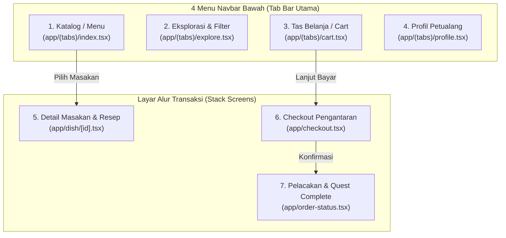
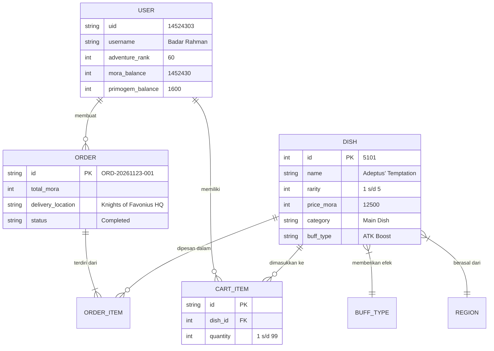

# Teyvat Delicacies — Aplikasi Pemesanan Makanan Bertema Genshin Impact

* **Mata Kuliah**: Pemrograman Visual I (`TI361`) — Tugas Pertemuan 7
* **Mahasiswa**: Badar Rahman
* **NIM**: `14524303` (Kelas `TI-1`, Semester 5)
* **Institusi**: STIKOM Poltek Cirebon
* **Target Platform**: Mobile (React Native + Expo Router)
* **Gaya Visual**: Fantasy RPG UI otentik bernuansa *Genshin Impact* (*Anti-Slop*, Bebas Emoji Unicode)

---

## 1. Ringkasan Proyek & Spesifikasi Tugas

Proyek ini merupakan rancangan arsitektur dan sistem aset aplikasi pemesanan makanan berbasis mobile bertema kuliner dunia Teyvat (*Genshin Impact*). Aplikasi dirancang secara presisi untuk memenuhi standar **Tugas 7 Pemrograman Visual**, berfokus pada kebersihan frontend, integritas sistem desain, kelengkapan aset visual/audio lokal, serta kemudahan generasi UI via **Google AI Studio / Google Stitch**.

### Fitur Utama Aplikasi:
1. **Pintu Masuk Gerbang Celestia (Entrance Screen)**: Latar belakang 5K/1080p resmi gerbang login screen Genshin dengan animasi ketuk untuk masuk (*Tap to Enter*).
2. **Katalog Masakan Two-Tone (Card Catalog)**: Kartu masakan bernuansa kertas kuno (*parchment*) dengan header warna dinamis sesuai tingkatan bintang (1* s/d 5*).
3. **Multi-Filter Efek Khasiat (Buff System)**: Filter masakan berdasarkan peningkatan status karakter (*ATK Boost, DEF Boost, HP Recovery, Stamina*).
4. **Mata Uang & Poin Teyvat**: Seluruh transaksi menggunakan koin emas Mora (`Mora`), kupon pesanan *Intertwined Fate*, serta saldo Primogem petualang.
5. **Keranjang & Checkout Kilat Glider**: Penghitungan porsi, input voucher diskon, pemilihan titik antar markas Teyvat, dan modal dialog legendaris *"QUEST COMPLETE: Feast Delivered!"*.

---

## 2. Struktur Navigasi (4 Menu Navbar Bawah + 3 Stack Screens)



---

## 3. Relasi Data & Skema Entitas (ERD)

Untuk dokumentasi lengkap skema TypeScript dan interface data, lihat [DATA_MODEL_DAN_RELASI.md](./DATA_MODEL_DAN_RELASI.md).



---

## 4. Indeks Berkas Dokumentasi & Blueprint Proyek

| Berkas | Deskripsi & Isi |
| :--- | :--- |
| **[PRD_TEYVAT_DELICACIES.md](./PRD_TEYVAT_DELICACIES.md)** | **Product Requirements Document (PRD)** resmi memuat latar belakang, target platform, tech stack, dan spesifikasi 7 layar. |
| **[AI_STUDIO_INSTRUCTIONS_AND_PROMPTS.md](./AI_STUDIO_INSTRUCTIONS_AND_PROMPTS.md)** | **Instruksi & Prompt Terpisah (English)** untuk Google AI Studio / Google Stitch: System Instructions vs Task Prompt. |
| **[KONTEKS_LENGKAP_DAN_ASET_UNTUK_GOOGLE_STITCH.md](./KONTEKS_LENGKAP_DAN_ASET_UNTUK_GOOGLE_STITCH.md)** | **Single Source of Truth** untuk Google AI Studio & Stitch. Memuat Master Prompt, daftar URL transparan CDN HTTP 200, aturan anti-slop, dan token warna hex. |
| **[BLUEPRINT_KONSEP_UIUX_FLOWCHART_DAN_ASET_GENSHIN.md](./BLUEPRINT_KONSEP_UIUX_FLOWCHART_DAN_ASET_GENSHIN.md)** | Blueprint arsitektur visual per layar, user journey flowchart, dan tabel audit aset 100% lengkap. |
| **[DATA_MODEL_DAN_RELASI.md](./DATA_MODEL_DAN_RELASI.md)** | Skema ERD data, kontrak interface TypeScript type-safe, dan format global state store (Zustand/Context). |
| **[KONSEP_APLIKASI_DAN_DESAIN_SYSTEM_GENSHIN_LENGKAP.md](./KONSEP_APLIKASI_DAN_DESAIN_SYSTEM_GENSHIN_LENGKAP.md)** | Panduan mendalam design system, tipografi, grid system, dan filosofi UI/UX Teyvat. |
| **[RESEARCH_ASSETS_DAN_DESIGN_SYSTEM_GENSHIN.md](./RESEARCH_ASSETS_DAN_DESIGN_SYSTEM_GENSHIN.md)** | Riset orisinal warna, font cufonfonts HYWenHei 85W, dan sumber aset in-game. |
| **[SPESIFIKASI_TUGAS_7_PEMVIS.md](./SPESIFIKASI_TUGAS_7_PEMVIS.md)** | Spesifikasi akademik dari RPS & tugas dosen pertemuan 7. |

---

## 5. Direktori Aset Lengkap (`assets/`)

Semua aset lokal telah diunduh, diverifikasi, dan siap digunakan secara offline:

```text
assets/
├── fonts/
│   ├── GenshinFont.ttf                   <-- Font resmi HYWenHei 85W (7.2 MB)
│   ├── zhcn.ttf                          <-- Master font bawaan cufonfonts
│   └── genshin_icons.svg                 <-- 87 vektor ikon resmi SVG (elemen, bintang, weapon, tab)
│
├── backgrounds/
│   ├── genshin_celestia_login_door_5k.png    <-- Wallpaper Asli 5K Gerbang Celestia (5120x2880, 21 MB)
│   ├── genshin_celestia_login_door_1080p.webp <-- Versi 1080p Mobile-Optimized (243 KB)
│   ├── celestia_entrance_bg.webp             <-- Latar pilar langit malam Teyvat
│   ├── dish_detail_bg.webp                   <-- Latar halaman detail resep
│   ├── constellation_stars_bg.webp           <-- Latar partikel bintang konstelasi
│   └── wish-background.webp                  <-- Latar gacha langit malam
│
├── audio/
│   ├── teyvat_ambient_bgm.ogg            <-- Musik latar suasana Teyvat (1.3 MB)
│   ├── quest_complete_jingle.ogg         <-- SFX denting pesanan berhasil (11.9 KB)
│   ├── legendary_dish_sfx.ogg            <-- SFX jingle masakan bintang 5 (32.3 KB)
│   └── epic_dish_sfx.ogg                 <-- SFX jingle masakan bintang 4 (27.1 KB)
│
├── ui/
│   ├── genshin_logo.webp                 <-- Logo resmi Genshin Impact transparan
│   ├── gold_button_texture.webp          <-- Tekstur tombol kapsul emas asli
│   ├── modal_ornament_icon.png           <-- Ornamen bingkai modal dialog
│   ├── paimon_hungry_mascot.png          <-- Maskot Paimon lapar (207 KB)
│   └── result_card_bg.webp               <-- Latar kartu hasil pesanan
│
├── icons/
│   ├── mora.png                          <-- Koin emas Mora
│   ├── primogem.png                      <-- Ikon Primogem
│   ├── genesis_crystal.png               <-- Ikon Genesis Crystal
│   ├── intertwined_fate.png              <-- Ikon kupon diskon
│   ├── fragile_resin.png                 <-- Ikon voucher kirim kilat
│   ├── crown_of_insight.png              <-- Ikon badge kehormatan
│   ├── bg_3star.webp, bg_4star.webp, bg_5star.webp <-- Latar grading bintang
│   ├── resultcard_bg.svg                 <-- Ornamen kartu vektor
│   ├── buff_atk_add.png                  <-- Ikon Buff ATK
│   ├── buff_def_add.png                  <-- Ikon Buff DEF
│   ├── buff_recovery_hp.png              <-- Ikon Buff Pemulihan HP
│   ├── buff_recovery_revive.png          <-- Ikon Buff Revive
│   └── buff_stamina_reduce.png           <-- Ikon Buff Pengurangan Stamina
│
└── dishes/ (12 Masakan Transparan Ikonik Mode Offline)
    ├── adeptus_temptation.png, sweet_madame.png, barbatos_ratatouille.png
    ├── almond_tofu.png, jade_parcels.png, golden_shrimp_balls.png
    ├── matsutake_meat_rolls.png, fishermans_toast.png, mushroom_pizza.png
    └── tri_color_dango.png, shawarma_wrap.png, tonkotsu_ramen.png
```

---

## 6. Token Desain & Kode Warna Hex Resmi

* **Parchment Card Body**: `#E9E5DC`
* **Sub-Container & Input**: `#F5F2EB`
* **Obsidian Deep Surface**: `#171421` / `#1D1A2A`
* **Genshin Indigo Border**: `#5D5187`
* **Genshin Gold Accent**: `#FFE7A5`
* **Primary Gold Pill Button**: Gradasi `#ECE5D8` menuju `#D3BC8E` (border `#FFE7A5`, teks `#3B4255`)
* **Tingkat Kelangkaan (Rarity Headers)**:
  * 1* Common: `#818486`
  * 2* Uncommon: `#5A977A`
  * 3* Rare: `#5987AD`
  * 4* Epic: `#9470BB`
  * 5* Legendary: `#C87C24`

---

## 7. Master Prompt Google Stitch / AI Studio (Siap Salin)

Salin teks berikut langsung ke kolom instruksi Google AI Studio atau Google Stitch:

```markdown
Build a production-grade React Native & Expo mobile food ordering application UI named "Teyvat Delicacies" featuring an authentic, meticulous Genshin Impact fantasy RPG aesthetic.

CRITICAL DESIGN RULES (ANTI-SLOP & STRICT THEME FIDELITY):
1. ABSOLUTE BAN ON UNICODE EMOJIS:
   - Do NOT use unicode emojis (no coin, sword, shield, cart, gem, checkmark, heart emojis).
   - Use official Genshin asset transparent PNGs or SVGs provided in the asset list, or clean text labels.
2. Color Palette:
   - Card Content Body: Authentic parchment cream (#E9E5DC).
   - Inner Containers & Inputs: Light cream (#F5F2EB).
   - Card Top Rarity Headers: 1-Star Grey (#818486), 2-Star Green (#5A977A), 3-Star Blue (#5987AD), 4-Star Epic Purple (#9470BB), 5-Star Legendary Gold (#C87C24).
   - Deep Background: Dark obsidian navy (#171421 / #1D1A2A).
   - Accent Borders: Gold stroke (#FFE7A5) and subtle indigo outline (#5D5187).
   - Primary Buttons: Elongated gold pill capsule (gradient #ECE5D8 to #D3BC8E, border: 1.5px solid #FFE7A5, text: bold #3B4255).
3. Typography:
   - Primary headings & titles must use the official Genshin display font HYWenHei 85W ("GenshinFont").
   - Numbers and prices must be clear and crisp.
4. Currency & Motifs:
   - Currency is Mora. Use the official Mora coin icon (https://enka.network/ui/UI_ItemIcon_202.png).
   - All star ratings use 4-point diamond star motifs (*), never generic 5-point cartoon stars.
   - Bullet points use diamond shapes (◆).

PAGES TO RENDER (CLEAN, 4-SCREEN FOCUSED FLOW):
1. Catalog Screen (Home):
   - Header with Traveler profile avatar, Mora coin balance (Mora 1,452,430), and search input.
   - Horizontal category filter pills: "All Dishes", "Main Dish", "Snacks", "Beverages". (Region tags like Nod-Krai, Liyue, Mondstadt are optional metadata badges on dishes).
   - Two-Tone Food Card Grid: Top banner colored by star rarity with transparent dish image overlapping on the right and 4-point diamond stars on bottom-left. Bottom body in parchment cream (#E9E5DC) with bold dish title, buff badge, price in Mora, and a mini gold "+" button.
   - Floating Quick Cart Bar at bottom when items are in cart.
2. Dish Detail Screen:
   - Large transparent dish hero image with subtle elemental glow.
   - 4-point diamond rarity stars.
   - Parchment paper detail card: in-game stat buff info with official buff icon (ATK, DEF, Recovery, or Stamina), recipe ingredient items grid, and food lore.
   - Portion quantity stepper (- / +) and sticky primary gold pill button: "Add to Order — [Price] Mora".
3. Cart Screen:
   - Itemized order list with inline quantity steppers and delete action.
   - Intertwined Fate promo code input (e.g., "PAIMONKENYANG").
   - Summary card with subtotal, glider courier fee, discount, and final Mora total.
   - Primary gold button: "Proceed to Glider Delivery".
4. Checkout & Order Complete Screen:
   - Delivery point selector (e.g., Knights of Favonius HQ, Wanmin Terrace).
   - Payment method toggle (Mora Cash on Delivery vs Northland Bank Card).
   - Special kitchen instructions field.
   - "Confirm Order" button that triggers an authentic Genshin golden dialog modal: "QUEST COMPLETE: Feast Delivered!" with estimated delivery time and a "Return to Home" button.

ASSET CDN REFERENCES:
- Mora Coin: https://enka.network/ui/UI_ItemIcon_202.png
- Primogem: https://enka.network/ui/UI_ItemIcon_201.png
- Intertwined Fate: https://enka.network/ui/UI_ItemIcon_223.png
- Adeptus' Temptation (5*): https://gi.yatta.moe/assets/UI/UI_ItemIcon_108123.png
- Jade Parcels (4*): https://gi.yatta.moe/assets/UI/UI_ItemIcon_108122.png
- Golden Shrimp Balls (3*): https://gi.yatta.moe/assets/UI/UI_ItemIcon_108126.png
- Sweet Madame (2*): https://gi.yatta.moe/assets/UI/UI_ItemIcon_108115.png
- Dango Milk (2*): https://gi.yatta.moe/assets/UI/UI_ItemIcon_101514.png
- Mora Meat (1*): https://gi.yatta.moe/assets/UI/UI_ItemIcon_108101.png
- Buff ATK: https://gi.yatta.moe/assets/UI/UI_Buff_Item_Atk_Add.png
- Buff DEF: https://gi.yatta.moe/assets/UI/UI_Buff_Item_Def_Add.png
- Buff HP: https://gi.yatta.moe/assets/UI/UI_Buff_Item_Recovery_HpAdd.png
- Navigation Icons: https://raw.githubusercontent.com/kgirtxd/Genshin-Assets/master/Misc/items.png
```
