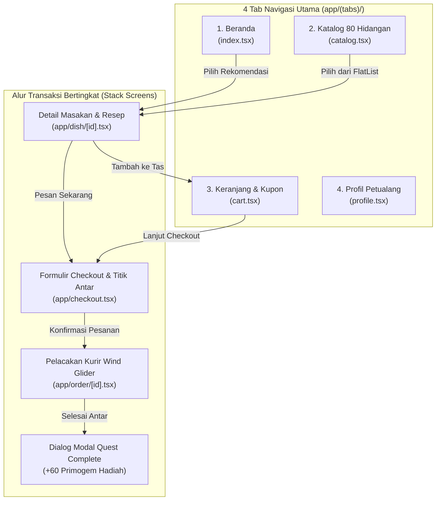
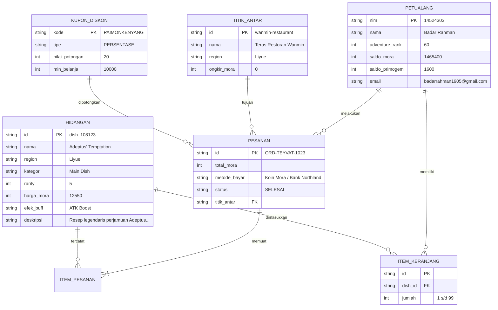

# Teyvat Delicacies - Pemvis Tugas 7: Aplikasi Pemesanan Makanan Mobile

Aplikasi mobile katalog dan pemesanan kuliner bertema fantasi RPG dunia Teyvat (*Genshin Impact*) berbasis **React Native** dan **Expo Router (File-Based Routing)**. Proyek ini dikembangkan secara komprehensif untuk memenuhi penugasan praktikum **Tugas 7 (Pertemuan 7)** mata kuliah **Pemrograman Visual I** pada Program Studi S1 Teknik Informatika STIKOM Poltek Cirebon.

---

## Identitas Pengembang & Penugasan Akademik

- **Nama Mahasiswa** : Badar Rahman
- **NIM**            : `14524303`
- **Program Studi**  : S1 Teknik Informatika
- **Kelas**          : TI-1
- **Semester**       : 5 (Ganjil)
- **Perguruan Tinggi**: STIKOM Poltek Cirebon
- **Mata Kuliah**    : Pemrograman Visual I (`TI361`)
- **Penugasan**      : Tugas 7 (Pertemuan 7 - Navigasi & File-Based Routing)
- **Dosen Pengampu** : Rifky Hilmanudin, S.Kom., M.Kom.
- **Repositori Git** : [https://github.com/DarRahman/teyvat-delicacies](https://github.com/DarRahman/teyvat-delicacies)

---

## Ringkasan Proyek

Aplikasi **Teyvat Delicacies** menyajikan pengalaman pemesanan makanan imersif dengan mengadaptasi sistem antarmuka bertema *parchment cream*, bingkai emas antik (*antique gold*), dan tipografi khas RPG. Dibangun menggunakan arsitektur **File-Based Routing** murni pada direktori `app/`, aplikasi mendukung navigasi multihalaman bertingkat (*nested routing*), pengelolaan status global (*state management*) tersinkronisasi, serta pemenuhan 100% rubrik penilaian dosen pengampu.

### Fitur Unggulan Aplikasi:
1. **Beranda Interaktif**: Memuat sambutan petualang, banner promosi kuliner, 5 hidangan rekomendasi utama Chef Xiangling, dan pintasan 4 kategori masakan.
2. **Katalog Terintegrasi 80 Hidangan (8 Region Teyvat)**: Menampilkan 80 masakan resmi dari seluruh region (Mondstadt, Liyue, Inazuma, Sumeru, Fontaine, Natlan, Nod-Krai, Snezhnaya) dengan virtualisasi memori performa tinggi menggunakan komponen `FlatList`.
3. **Pencarian & Multi-Filter Khasiat (*Buff*)**: Filter instan berdasarkan nama hidangan, kategori (*Main Dish, Snacks, Beverages*), serta status tempur in-game (*ATK Boost, DEF Boost, HP Recovery, Stamina*).
4. **Detail Hidangan & Resep Dinamis**: Halaman detail berbasis parameter rute dinamis (`app/dish/[id].tsx`) memuat deskripsi naratif (*lore*), grid bahan baku memasak (*ingredients*), serta indikator efek buff.
5. **Keranjang Belanja & Validasi Kupon Ketat**: Perhitungan porsi dinamis, subtotal, ongkir kurir glider, dan sistem penebusan voucher diskon resmi (*PAIMONKENYANG, GLIDERFREE, ADEPTEUSFEAST*).
6. **Alur Checkout & Titik Antar Waypoint**: Pilihan 8 titik antar markas besar Teyvat dengan modal visual peta benua, opsi metode pembayaran (Koin Mora Tunai vs Saldo Bank Northland), serta instruksi khusus dapur.
7. **Pelacakan Kurir Glider & Modal Quest Complete**: Layar pelacakan kurir *Wind Glider* waktu nyata dengan animasi pendaratan dan dialog penyelesaian pesanan legendaris *"QUEST COMPLETE: Feast Delivered!"* yang memberikan hadiah saldo Primogem.
8. **Profil Petualang & Pengaturan Terpadu**: Menampilkan identitas resmi pengembang Badar Rahman (NIM `14524303`), AR 60, email `badarrahman1905@gmail.com`, saldo mata uang, koleksi kartu nama (*Namecard*), penukaran berkah Mora Ley Line, dan modal informasi aplikasi.

---

## Struktur Direktori & Arsitektur Berkas Proyek

Proyek ini menggunakan struktur standar Expo Router dengan pemisahan direktori kode sumber mobile (`expo-mobile/`) dan simulator web (`src/`):

```text
teyvat-delicacies/
├── README.md                          # Dokumentasi resmi akademik proyek Tugas 7
├── PRD_TEYVAT_DELICACIES.md           # Product Requirements Document & spesifikasi teknis
├── SPESIFIKASI_TUGAS_7_PEMVIS.md      # Salinan transkrip rubrik soal resmi dosen
├── package.json                       # Konfigurasi dependensi simulator root
├── tsconfig.json                      # Konfigurasi TypeScript root
├── vite.config.ts                     # Konfigurasi Vite dev server
├── index.html                         # Dokumen HTML simulator web
├── assets/                            # Koleksi aset visual dan media game
│   ├── backgrounds/                   # Citra latar belakang gerbang Celestia & konstelasi
│   ├── dishes/                        # Berkas PNG transparan masakan utama
│   ├── icons/                         # Ikon mata uang Mora, Primogem, buff, dan fate
│   ├── map/                           # Peta benua Teyvat resolusi tinggi 8 region
│   ├── namecards/                     # Panji kartu nama karakter & wilayah
│   └── ui/                            # Ornamen belah ketupat, divider, dan logo
├── expo-mobile/                       # Subproyek utama aplikasi React Native Expo
│   ├── app.json                       # Metadata aplikasi Expo SDK 52 (Nama, Slug, Ikon)
│   ├── package.json                   # Dependensi pustaka mobile (React 18, Expo 52, Zustand)
│   ├── tsconfig.json                  # Konfigurasi TypeScript mobile
│   ├── app/                           # File-Based Routing (Expo Router)
│   │   ├── _layout.tsx                # Root layout, Stack navigator, safe area & toast
│   │   ├── index.tsx                  # Layar pembuka (Celestia Gate Entrance Screen)
│   │   ├── checkout.tsx               # Layar transaksi & pemilihan titik antar Waypoint
│   │   ├── (tabs)/                    # 4 Layar Bottom Tab Utama
│   │   │   ├── _layout.tsx            # Konfigurasi Tabs navigator (Tab Bar styling)
│   │   │   ├── index.tsx              # Tab 1: Halaman Beranda (Home & Recommendations)
│   │   │   ├── catalog.tsx            # Tab 2: Halaman Katalog Hidangan (FlatList 80 hidangan)
│   │   │   ├── cart.tsx               # Tab 3: Halaman Keranjang Belanja & Kupon
│   │   │   └── profile.tsx            # Tab 4: Halaman Profil Mahasiswa & Pengaturan
│   │   ├── dish/
│   │   │   └── [id].tsx               # Layar dinamis Detail Masakan, Resep & Buff
│   │   └── order/
│   │       └── [id].tsx               # Layar Pelacakan Glider & Quest Complete Modal
│   ├── components/
│   │   └── TeyvatUI.tsx               # Komponen antarmuka modular (ParchmentCard, Buttons, Modal)
│   ├── data/
│   │   ├── assets.ts                  # Resolusi impor aset lokal terpusat
│   │   ├── dishes.ts                  # Metadata 16 hidangan kurasi & titik antar wilayah
│   │   └── yattaCatalog.ts            # Basis data 80 hidangan resmi 8 region Teyvat
│   ├── lib/
│   │   └── delicaciesRules.ts         # Aturan bisnis (ongkir, kupon diskon, kalkulasi Mora)
│   ├── store/
│   │   └── useDelicaciesStore.ts      # State management terpusat (Zustand + AsyncStorage)
│   └── theme/
│       └── tokens.ts                  # Token desain resmi (Palet Hex, Font, Elevation)
└── src/                               # Simulator Web React + Tailwind CSS
    ├── App.tsx                        # Root container web simulator
    ├── components/                    # Komponen antarmuka web
    ├── data/                          # Data hidangan simulator web
    ├── screens/                       # Layar simulasi desktop/web
    └── store/                         # State manager simulator web
```

---

## Pemenuhan 4 Butir Soal Tugas 7

### 1. Soal 1: Teori Navigasi pada Aplikasi Mobile
- **Definisi Navigasi**: Navigasi adalah mekanisme perpindahan antarlayar (*screens*) dan pengelolaan riwayat tampilan (*navigation stack*) dalam aplikasi mobile yang memungkinkan pengguna berinteraksi secara terstruktur, intuitif, dan efisien.
- **Kebutuhan Sistem Navigasi di React Native**: Berbeda dengan aplikasi web berbasis browser yang memiliki URL bar dan tombol *back/forward* native, aplikasi mobile React Native membutuhkan perutean berbasis status memori (*in-memory state*) untuk mengontrol peralihan tampilan, transisi animasi, serta manajemen tumpukan layar (*stack history*).
- **Jenis Navigator & Peruntukannya**:
  - **Stack Navigator**: Menumpuk layar baru di atas layar sebelumnya (LIFO — *Last In First Out*). Digunakan pada alur transaksi linear: `Katalog` $\to$ `Detail Masakan` $\to$ `Checkout` $\to$ `Pelacakan`.
  - **Tab Navigator**: Menyediakan bilah menu tetap di bagian bawah atau atas untuk beralih antarfungsi utama secara instan tanpa kehilangan status layar lain. Digunakan pada 4 tab utama: `Beranda`, `Katalog`, `Keranjang`, dan `Profil`.
  - **Drawer Navigator**: Menu panel tersembunyi yang muncul dari sisi samping layar (*slide-out sidebar*), ideal untuk aplikasi dengan struktur menu yang sangat banyak seperti aplikasi enterprise atau portal berita.

### 2. Soal 2: Perbandingan React Navigation vs Expo Router

| Aspek Perbandingan | React Navigation (Imperatif / Konvensional) | Expo Router (Deklaratif / File-Based) |
| :--- | :--- | :--- |
| **Pendekatan Navigasi** | Komponen berbasis kode deklaratif terpisah (`<NavigationContainer>`, `<Stack.Navigator>`). | Navigasi berbasis struktur direktori berkas (*File-Based Routing* terinspirasi Next.js). |
| **Pendefinisian Rute** | Rute harus didaftarkan satu per satu secara manual di berkas konfigurasi (`App.tsx` atau `navigation.ts`). | Rute otomatis tercipta berdasarkan keberadaan berkas di dalam folder `app/`. |
| **Struktur Berkas** | Bebas, namun memerlukan perakitan rute manual di banyak berkas. | Standar konvensional: `app/` untuk rute, `_layout.tsx` untuk template wrapper, dan `[param].tsx` untuk rute dinamis. |
| **Cara Berpindah Halaman** | `navigation.navigate('DishDetail', { id: '5101' })`. | `router.push('/dish/5101')` atau `<Link href="/dish/5101">`. |
| **Dukungan Deep Linking** | Memerlukan konfigurasi *prefixes* dan *path mapping* yang rumit. | *Out-of-the-box*: setiap file secara otomatis merupakan tautan universal (*universal deep link*). |

### 3. Soal 3: Struktur File dan Penentuan Rute pada Expo Router
- **Folder `app/`**: Direktori akar (*root directory*) tempat seluruh rute halaman didefinisikan. Setiap berkas `.tsx` yang berada di dalam folder ini merepresentasikan sebuah alamat rute aplikasi.
- **File `_layout.tsx`**: Berkas pembungkus (*layout wrapper*) yang mendefinisikan struktur navigator bersama (seperti Stack atau Tabs), safe area, penyedia konteks, serta elemen global (seperti Toast notifikasi) yang tetap bertahan saat halaman di dalamnya berpindah.
- **File `index.tsx`**: Merepresentasikan rute default atau beranda dari direktori tempat berkas tersebut berada (misalnya `app/index.tsx` untuk rute `/`, dan `app/(tabs)/index.tsx` untuk rute tab pertama).
- **Grup Rute `(folder)/`**: Tanda kurung menandakan rute grup tanpa memengaruhi segmen URL, sangat berguna untuk mengelompokkan Tab Navigation (`app/(tabs)/`).
- **Rute Dinamis `[param].tsx`**: Nama berkas di dalam tanda kurung siku (seperti `app/dish/[id].tsx`) menangani parameter dinamis URL yang dibaca melalui hook `useLocalSearchParams()`.

### 4. Soal 4: Implementasi Praktik Aplikasi "Teyvat Delicacies"



---

## Diagram Hubungan Data (Entity Relationship Diagram - ERD)



---

## Panduan Menjalankan Aplikasi

### Kebutuhan Lingkungan (Prerequisites)
- **Node.js**: v18.0.0 atau lebih baru
- **NPM** atau **Bun** package manager
- **Expo Go App**: Terinstal di perangkat smartphone Android / iOS fisik, atau simulator Android Studio / Xcode.

### 1. Menjalankan Aplikasi Mobile (Expo Go)
Buka terminal dan arahkan ke subdirektori mobile:
```bash
cd expo-mobile
npm install
npx expo start -c
```
- Pindai (*scan*) kode QR yang muncul di terminal menggunakan aplikasi **Expo Go** pada ponsel Anda (pastikan ponsel dan laptop berada dalam satu jaringan Wi-Fi yang sama).
- Tekan `r` di konsol untuk memuat ulang (*reload*) aplikasi secara instan.

### 2. Menjalankan Pengujian Tipe TypeScript
Untuk memvalidasi integritas kode TypeScript pada subproyek mobile:
```bash
cd expo-mobile
npm run typecheck
```

### 3. Menjalankan Simulator Web Desktop
Untuk menjalankan versi simulasi antarmuka pada peramban web desktop:
```bash
npm install
npm run dev
```
Buka `http://localhost:3000` pada peramban web Google Chrome atau Edge.

---

## Lisensi & Hak Cipta

Proyek ini disusun oleh **Badar Rahman** untuk keperluan akademik penugasan mata kuliah **Pemrograman Visual I** di **STIKOM Poltek Cirebon**. Seluruh nama hidangan, konsep visual dunia Teyvat, karakter, dan aset ikonik merupakan hak kekayaan intelektual milik **HoYoverse (COGNOSPHERE PTE. LTD.)**.
