# Teyvat Delicacies - Pemvis Tugas 7: Aplikasi Katalog dan Pemesanan Makanan

[](https://github.com/DarRahman/teyvat-delicacies/releases/latest)
[](https://github.com/DarRahman/teyvat-delicacies/releases/latest)
[](https://expo.dev)

Aplikasi mobile katalog dan pemesanan kuliner bertema fantasi RPG dunia Teyvat (*Genshin Impact*) berbasis React Native dan Expo Router (Expo SDK 58). Proyek ini dikembangkan untuk memenuhi penugasan praktikum Tugas 7 (Pertemuan 7) mata kuliah Pemrograman Visual I pada program studi S1 Teknik Informatika STIKOM Poltek Cirebon.

> 📥 **Download File APK Siap Pakai**: File instalasi mandiri Android standalone (`.apk`) dapat diunduh langsung melalui halaman resmi [**GitHub Releases v1.0.0**](https://github.com/DarRahman/teyvat-delicacies/releases/tag/v1.0.0).

---

## Identitas Pengembang & Penugasan

- Nama Mahasiswa : Badar Rahman
- NIM            : 14524303
- Program Studi  : S1 Teknik Informatika
- Kelas          : TI-1
- Semester       : 5 (Ganjil)
- Kampus         : STIKOM Poltek Cirebon
- Mata Kuliah    : Pemrograman Visual I (TI361)
- Penugasan      : Tugas 7 (Pertemuan 7)
- Dosen Pengampu : Rifky Hilmanudin, S.Kom., M.Kom.
- Repositori Git : https://github.com/DarRahman/teyvat-delicacies

---

## Struktur Berkas & Arsitektur Direktori Proyek

```text
teyvat-delicacies/
├── README.md                          # Dokumentasi resmi proyek akademik Tugas 7
├── package.json                       # Konfigurasi dependensi simulator root
├── tsconfig.json                      # Konfigurasi TypeScript root
├── vite.config.ts                     # Konfigurasi bundler Vite dev server
├── index.html                         # Dokumen induk simulator web
├── assets/                            # Koleksi aset visual dan media game
│   ├── backgrounds/                   # Latar belakang gerbang Celestia & konstelasi
│   ├── dishes/                        # Berkas masakan utama format WebP & PNG
│   ├── icons/                         # Ikon mata uang Mora, Primogem, dan efek buff
│   ├── map/                           # Peta benua Teyvat resolusi tinggi 8 region
│   ├── namecards/                     # Panji kartu nama karakter & wilayah
│   └── ui/                            # Ornamen belah ketupat dan logo resmi
├── screenshots/                       # Dokumentasi 17 tangkapan layar antarmuka
│   ├── 01_layar_pembuka_celestia.jpg
│   ├── 02_beranda_rekomendasi.jpg
│   ├── 03_katalog_flatlist_panjang.jpg
│   ├── 04_katalog_filter_notifikasi.jpg
│   ├── 05_detail_masakan_resep.jpg
│   ├── 06_keranjang_kosong_paimon.jpg
│   ├── 07_keranjang_terisi_kupon.jpg
│   ├── 08_checkout_pengantaran.jpg
│   ├── 09_modal_peta_waypoint.jpg
│   ├── 10_pelacakan_glider_terbang.jpg
│   ├── 11_pelacakan_glider_tiba.jpg
│   ├── 12_modal_quest_complete.jpg
│   ├── 13_profil_lisensi_panjang.jpg
│   ├── 14_modal_koleksi_namecard.jpg
│   ├── 15_modal_paimon_bargains.jpg
│   ├── 16_modal_pengaturan_identitas.jpg
│   └── 17_modal_reset_data.jpg
├── expo-mobile/                       # Subproyek utama aplikasi React Native Expo
│   ├── app.json                       # Konfigurasi metadata aplikasi Expo SDK 58
│   ├── package.json                   # Dependensi mobile (React 19, Expo 58, Zustand)
│   ├── tsconfig.json                  # Konfigurasi TypeScript mobile
│   ├── app/                           # File-Based Routing (Expo Router)
│   │   ├── _layout.tsx                # Root layout, Stack navigator & screen options
│   │   ├── index.tsx                  # Layar pembuka (Celestia Gate Entrance Screen)
│   │   ├── checkout.tsx               # Layar formulir checkout & titik antar Waypoint
│   │   ├── (tabs)/                    # 4 Menu bilah navigasi bawah (Bottom Tabs)
│   │   │   ├── _layout.tsx            # Konfigurasi Tabs navigator & tab bar styling
│   │   │   ├── index.tsx              # Tab 1: Beranda & Rekomendasi Menu Kuliner
│   │   │   ├── catalog.tsx            # Tab 2: Katalog 80 Hidangan (FlatList)
│   │   │   ├── cart.tsx               # Tab 3: Keranjang Belanja & Validasi Kupon
│   │   │   └── profile.tsx            # Tab 4: Profil Petualang & Pengaturan
│   │   ├── dish/
│   │   │   └── [id].tsx               # Layar dinamis Detail Masakan, Lore & Resep
│   │   └── order/
│   │       └── [id].tsx               # Layar Pelacakan Glider & Konfirmasi Pesanan
│   ├── components/
│   │   └── TeyvatUI.tsx               # Komponen antarmuka modular (Cards, Modal, Buttons)
│   ├── data/
│   │   ├── assets.ts                  # Resolusi impor aset lokal terpusat
│   │   ├── dishes.ts                  # Metadata hidangan kurasi & titik antar wilayah
│   │   └── yattaCatalog.ts            # Basis data 80 hidangan resmi 8 region Teyvat
│   ├── lib/
│   │   └── delicaciesRules.ts         # Aturan bisnis (ongkir, kupon diskon, kalkulasi Mora)
│   ├── store/
│   │   └── useDelicaciesStore.ts      # State management terpusat (Zustand + AsyncStorage)
│   └── theme/
│       └── tokens.ts                  # Token desain resmi (Palet Hex, Font, Elevation)
└── src/                               # Simulator Web React + Tailwind CSS
    ├── App.tsx                        # Root container web simulator
    ├── components/                    # Komponen antarmuka web
    ├── data/                          # Data hidangan simulator web
    ├── screens/                       # Layar simulasi desktop/web
    └── store/                         # State manager simulator web
```

---

## Fitur Aplikasi

1. **Halaman Beranda & Rekomendasi Kuliner**  
   Menampilkan identitas aplikasi pemesanan kuliner, banner informasi aplikasi, hidangan rekomendasi terbaik lengkap dengan harga Mora dan lencana efek buff, serta tombol kategori menu (Makanan Utama, Minuman, Camilan).

2. **Katalog 80 Hidangan (FlatList)**  
   Menampilkan 80 masakan resmi dari 8 wilayah Teyvat (Mondstadt, Liyue, Inazuma, Sumeru, Fontaine, Natlan, Nod-Krai, Snezhnaya). Dirender menggunakan komponen performa tinggi `FlatList` dengan virtualisasi memori agar rendering tetap halus dan ringan di perangkat mobile.

3. **Pencarian Cepat & Filter Wilayah**  
   Fitur pencarian instan berdasarkan nama masakan (*Search Bar*) serta filter kategori dan asal wilayah untuk memudahkan pengguna menemukan kuliner yang diinginkan.

4. **Detail Masakan, Efek Buff & Resep Bahan**  
   Halaman detail dinamis berbasis parameter rute (`app/dish/[id].tsx`) menampilkan gambar hidangan, informasi asal wilayah, efek peningkatan status tempur (*Buff*), takaran bahan resep, pengatur porsi, serta tombol penambahan ke keranjang belanja.

5. **Keranjang Belanja & Validasi Kupon Diskon**  
   Daftar seluruh item pesanan aktif dengan kontrol kuantitas porsi (+ / -), subtotal harga, serta tombol hapus item. Dilengkapi sistem penebusan voucher diskon (*PAIMONKENYANG, GLIDERFREE, ADEPTEUSFEAST*) dengan validasi kuota dan syarat minimal belanja otomatis.

6. **Simulasi Checkout & Titik Antar Waypoint**  
   Ringkasan pesanan dengan pemilihan titik antar di 8 wilayah Teyvat yang dilengkapi modal peta dunia interaktif, rincian biaya ongkir kurir glider, serta tombol konfirmasi pesanan.

7. **Pelacakan Kurir Wind Glider & Konfirmasi Pesanan**  
   Simulasi pelacakan progres kurir *Wind Glider* waktu nyata dari dapur hingga mendarat di lokasi tujuan (progres 0% hingga 100%), yang diakhiri dengan tampilan modal dialog konfirmasi pesanan berhasil (*Quest Complete*) beserta faktur pembayaran lunas.

8. **Profil Petualang & Menu Pengaturan**  
   Menampilkan data profil resmi mahasiswa (Badar Rahman, NIM 14524303, AR 60, email `badarrahman1905@gmail.com`), fitur kustomisasi spanduk profil (*Namecard*), penukaran saldo Paimon's Bargains, formulir pembaruan identitas, serta tombol pemulihan data ke default pabrik (*Reset Data*).

---

## Arsitektur Navigasi & Expo Router

Proyek ini menerapkan arsitektur navigasi deklaratif berbasis berkas (*File-Based Routing*) menggunakan Expo Router:

1. **Folder `app/`**  
   Menjadi direktori akar tempat seluruh sistem perutean aplikasi didefinisikan secara otomatis tanpa konfigurasi rute imperatif manual.

2. **Root Layout (`app/_layout.tsx`)**  
   Membungkus tumpukan layar (*Stack Navigator*), menangani area aman (*SafeAreaProvider*), dan menampung komponen persisten seperti `TeyvatToast` di bagian atas layar agar tidak ter-unmount saat berpindah rute.

3. **Bottom Tab Navigation (`app/(tabs)/`)**  
   Mengelompokkan 4 menu utama (Beranda, Katalog, Keranjang, Profil) dalam satu navigator bilah bawah tetap menggunakan struktur grup rute `(tabs)` tanpa mengubah segmen URL.

4. **Nested Stack & Rute Dinamis (`app/dish/[id].tsx` & `app/order/[id].tsx`)**  
   Navigasi bertingkat dari tab Beranda/Katalog menuju layar detail masakan menggunakan parameter dinamis `[id]` yang ditangkap dengan hook `useLocalSearchParams()`, diteruskan ke layar `checkout.tsx`, dan berakhir pada pelacakan pesanan `order/[id].tsx`.

5. **State Management Terpusat (Zustand + AsyncStorage)**  
   Pengelolaan status keranjang, riwayat pesanan, profil petualang, serta saldo Mora dan Primogem tersinkronisasi secara reaktif dan persisten pada penyimpanan lokal perangkat.

---

## Tangkapan Layar Aplikasi

| 01. Layar Pembuka | 02. Keranjang Kosong | 03. Beranda Rekomendasi |
| :---: | :---: | :---: |
| 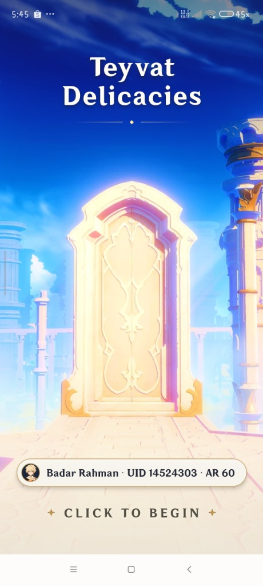 | 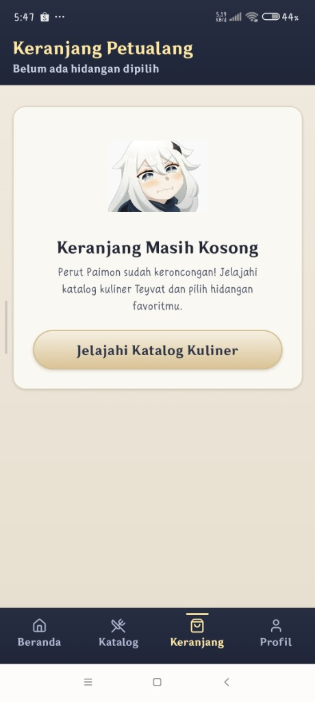 | 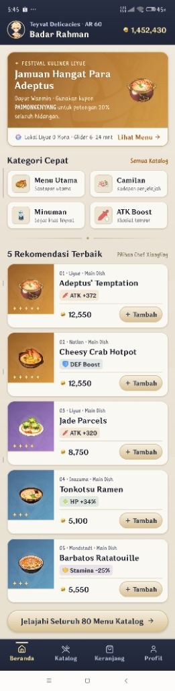 |

| 04. Katalog Hidangan | 05. Pencarian & Filter | 06. Detail Hidangan |
| :---: | :---: | :---: |
| 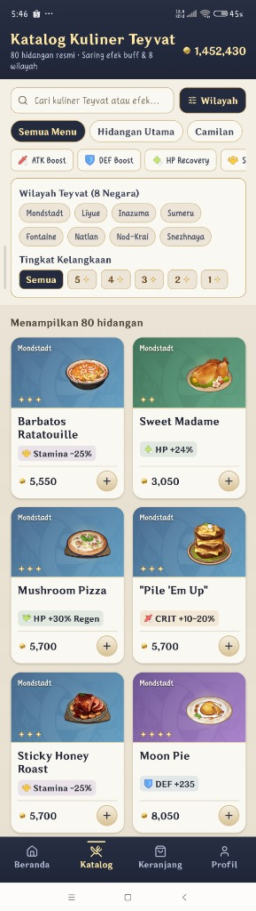 | 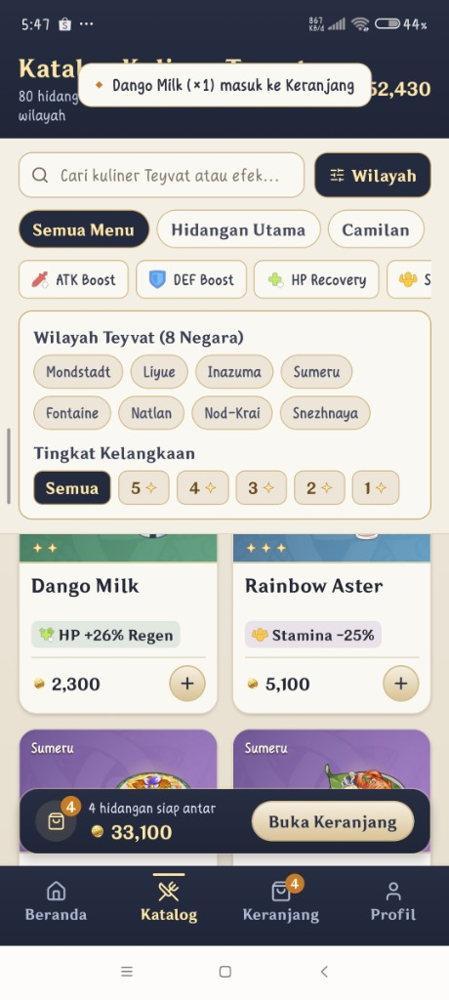 | 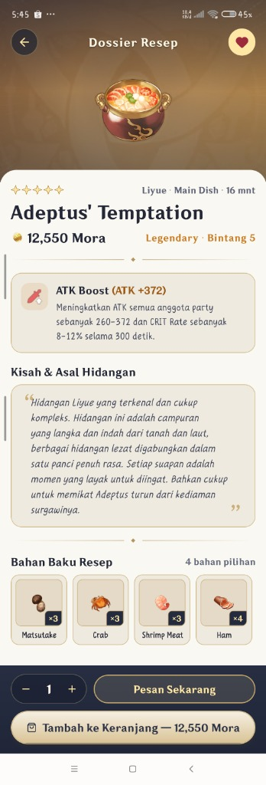 |

| 07. Keranjang Belanja | 08. Checkout Pengantaran | 09. Peta Lokasi Pengantaran |
| :---: | :---: | :---: |
| 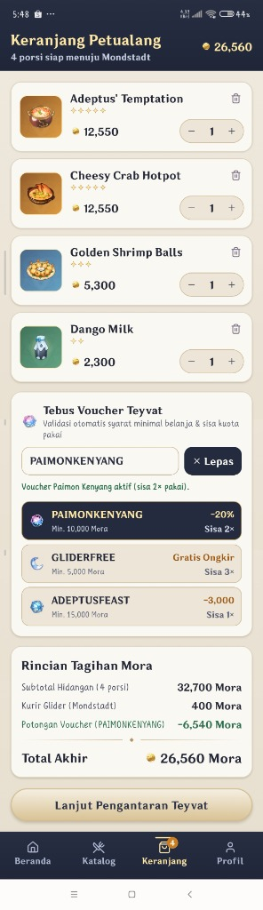 | 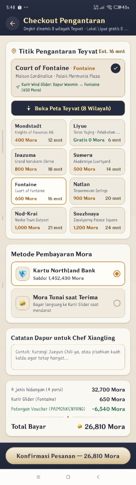 | 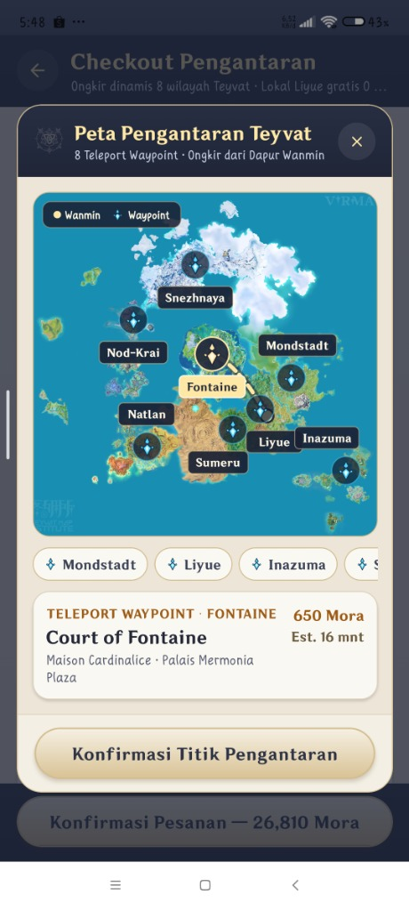 |

| 10. Pelacakan Kurir (Bagian 1) | 11. Pelacakan Kurir (Bagian 2) | 12. Konfirmasi Pesanan |
| :---: | :---: | :---: |
| 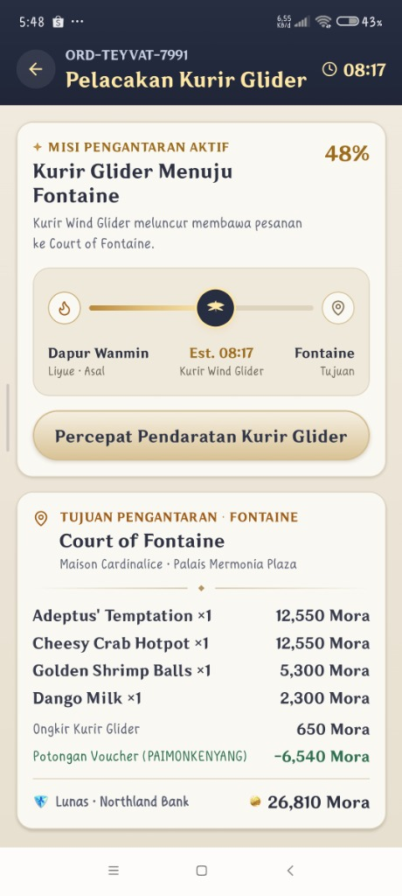 | 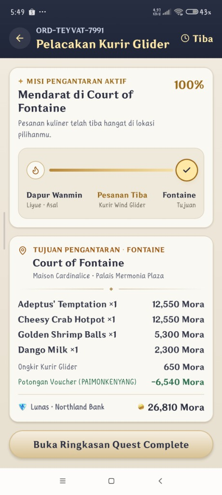 | 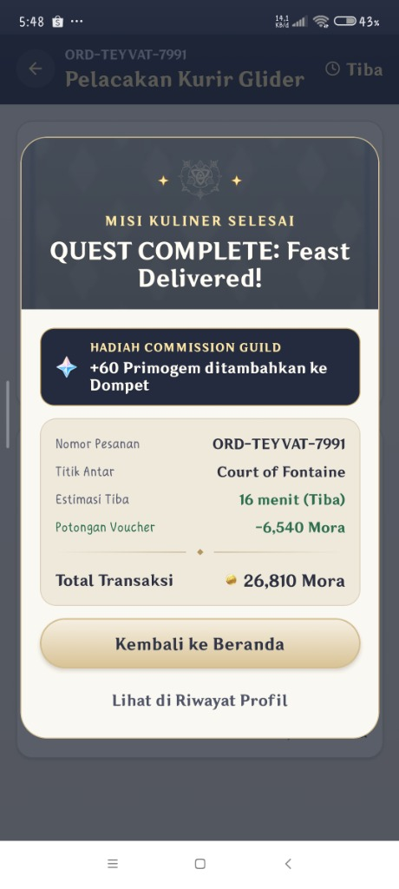 |

| 13. Profil Petualang | 14. Pengaturan Identitas | 15. Koleksi Namecard |
| :---: | :---: | :---: |
| 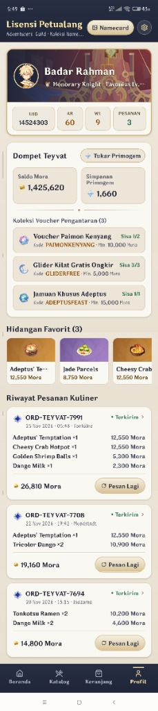 | 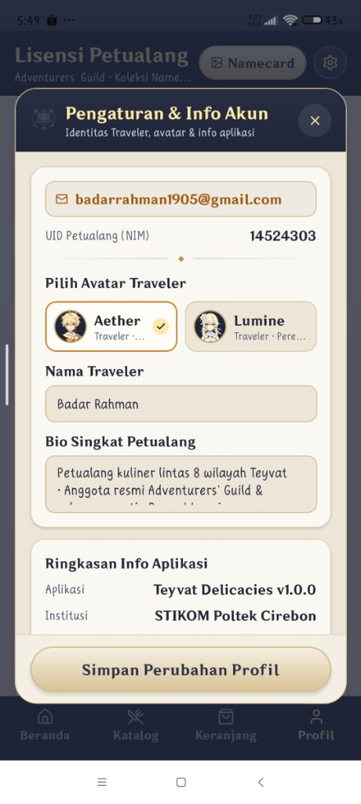 | 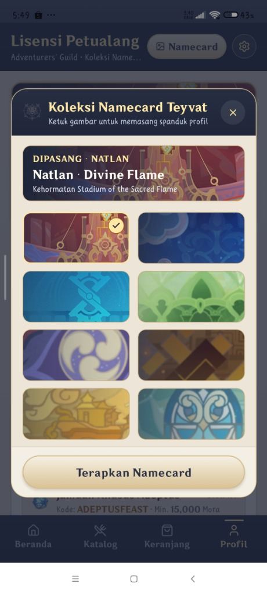 |

| 16. Paimon's Bargains | 17. Modal Reset Data | |
| :---: | :---: | :---: |
| 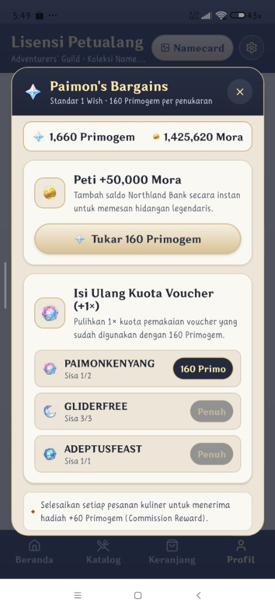 | 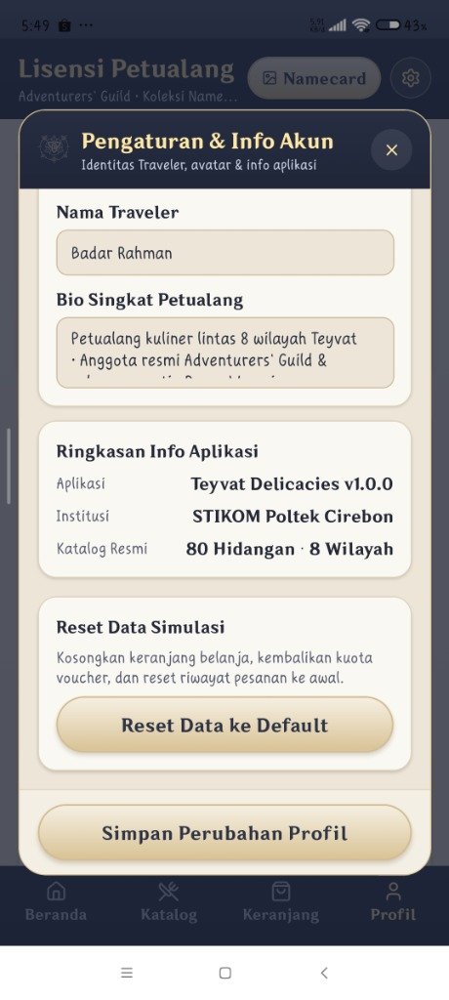 | |

---

## Petunjuk Menjalankan Aplikasi

Prasyarat: Node.js (versi 18 ke atas) dan npm telah terpasang pada komputer.

1. Kloning repositori proyek:
   ```bash
   git clone https://github.com/DarRahman/teyvat-delicacies.git
   cd teyvat-delicacies
   ```

2. Jalankan aplikasi mobile via Metro Bundler (Expo):
   ```bash
   cd expo-mobile
   npm install
   npx expo start -c
   ```

3. Buka aplikasi **Expo Go** pada perangkat smartphone fisik (Android / iOS) atau emulator, lalu pindai kode QR yang muncul di terminal (pastikan ponsel dan laptop terhubung dalam satu jaringan Wi-Fi yang sama).

4. Untuk memvalidasi integritas kode TypeScript pada subproyek mobile:
   ```bash
   npm run typecheck
   ```

5. (Opsional) Menjalankan simulator versi web desktop:
   ```bash
   cd ..
   npm install
   npm run dev
   ```
   Buka `http://localhost:3000` pada peramban web.

---

## Hak Cipta & Aset (Disclaimer)

Seluruh aset grafis, ilustrasi karakter, nama hidangan kuliner, dan elemen visual dunia Teyvat yang digunakan dalam proyek ini merupakan hak cipta milik **COGNOSPHERE PTE. LTD. (HoYoverse / Genshin Impact)**. Proyek ini dikembangkan secara independen murni untuk tujuan edukasi dan pemenuhan tugas akademik mata kuliah Pemrograman Visual I pada Program Studi S1 Teknik Informatika STIKOM Poltek Cirebon, tanpa tujuan komersial.

